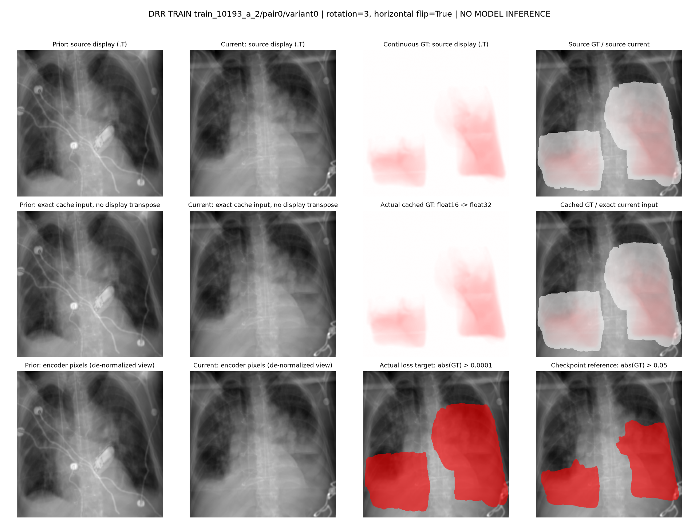
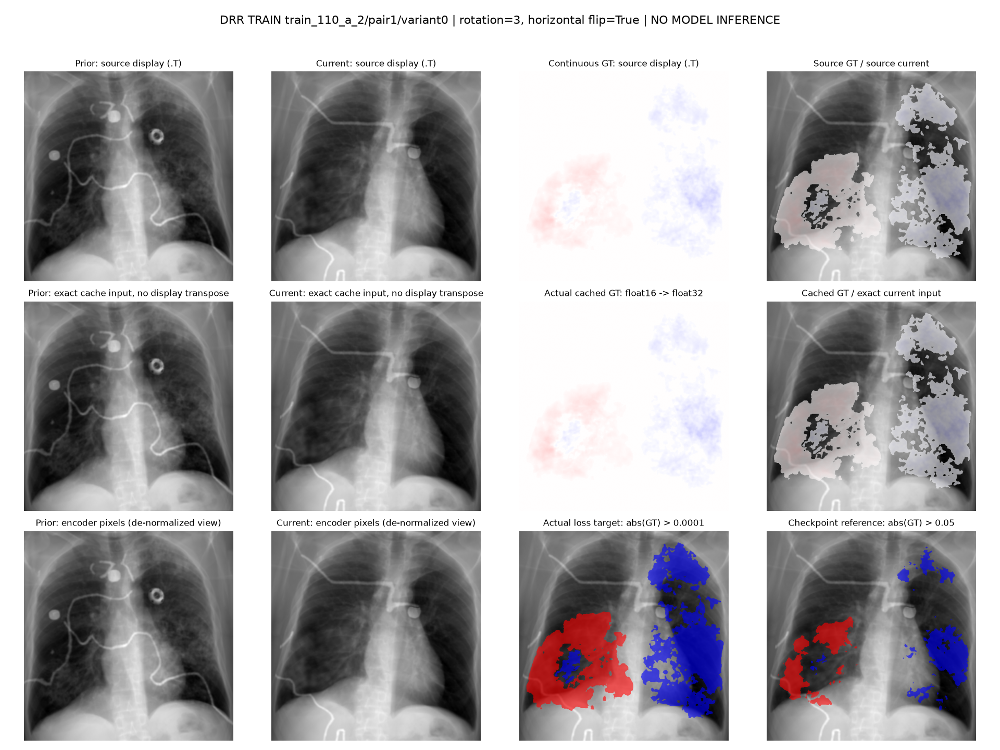
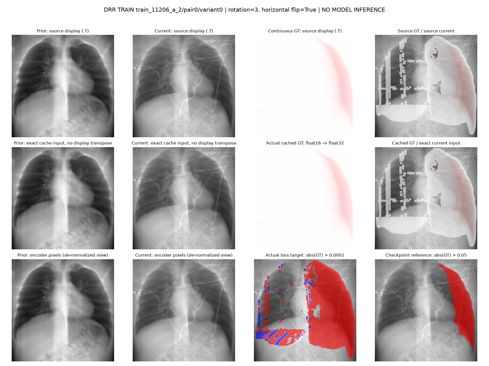
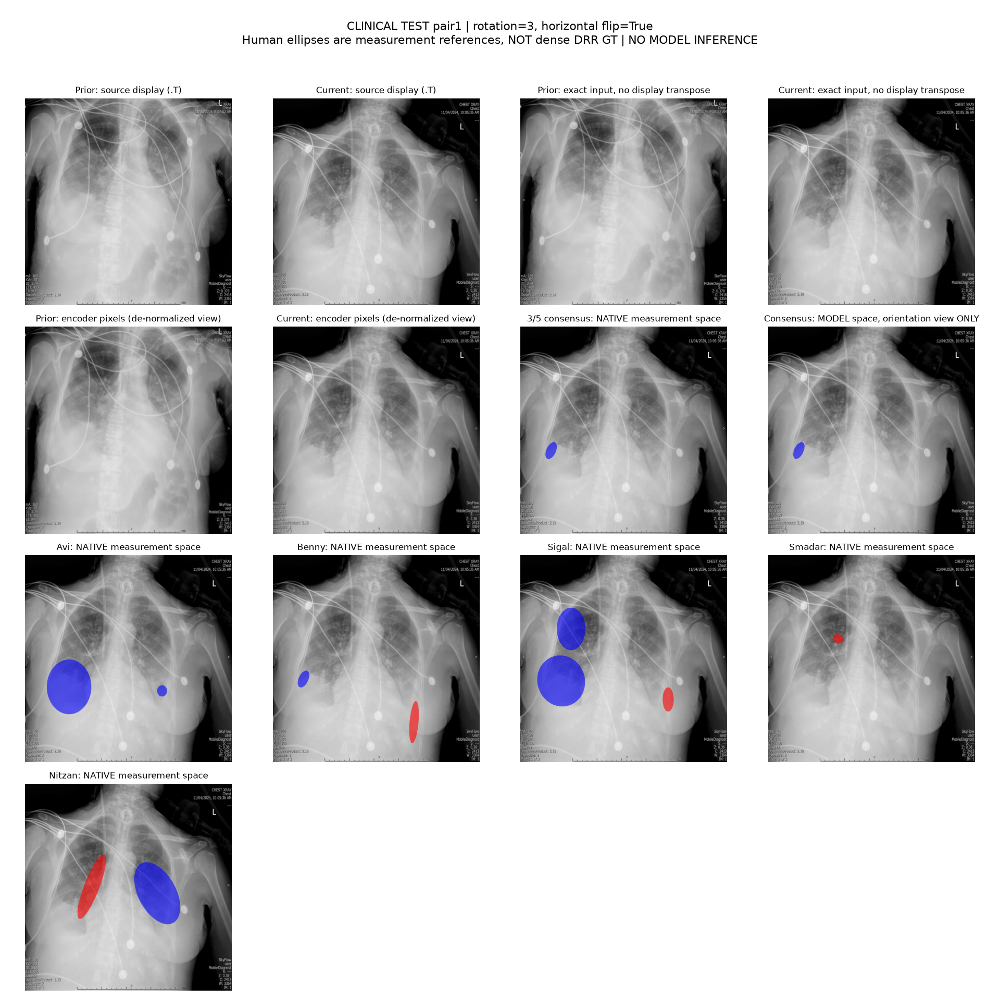
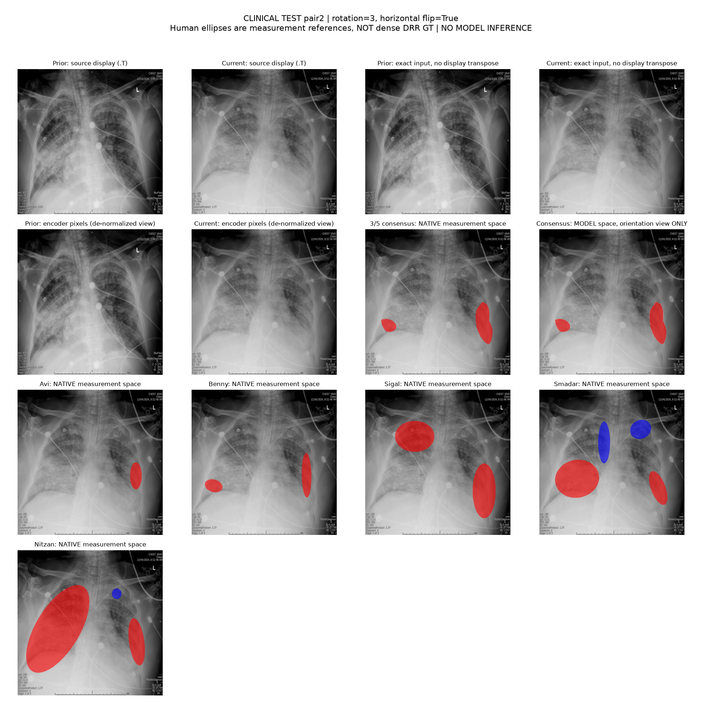
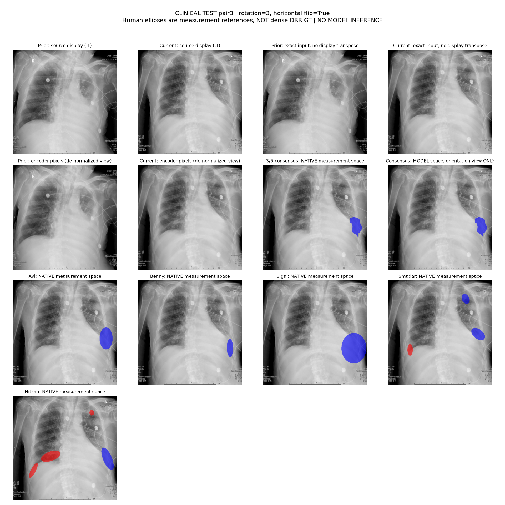

# Exact Cache Input and GT Evidence

Three synthetic training pairs and three clinical test pairs. No model weights or inference.

Use review.png to inspect orientation. exact_tensors.npz preserves the actual float tensors.
Encoder PNGs reverse channel normalization for visibility only.
Training target and checkpoint GT use different cutoffs, labelled separately.
Clinical doctors/consensus are native-coordinate measurement references, not dense GT.

## drr_train: train_10193_a_2/pair0/variant0

[Exact tensors](drr_1/exact_tensors.npz) | [Source provenance](drr_1/source.json)

## drr_train: train_110_a_2/pair1/variant0

[Exact tensors](drr_2/exact_tensors.npz) | [Source provenance](drr_2/source.json)

## drr_train: train_11206_a_2/pair0/variant0

[Exact tensors](drr_3/exact_tensors.npz) | [Source provenance](drr_3/source.json)

## clinical_test: pair1

[Exact tensors](clinical_pair1/exact_tensors.npz) | [Source provenance](clinical_pair1/source.json)

## clinical_test: pair2

[Exact tensors](clinical_pair2/exact_tensors.npz) | [Source provenance](clinical_pair2/source.json)

## clinical_test: pair3

[Exact tensors](clinical_pair3/exact_tensors.npz) | [Source provenance](clinical_pair3/source.json)

