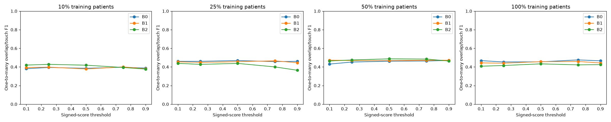
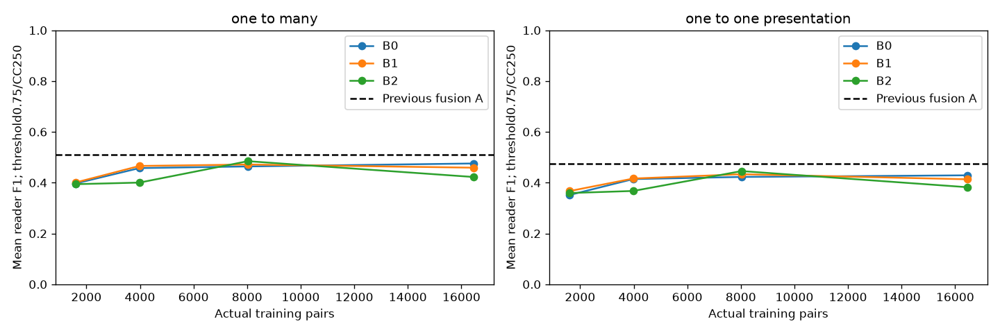

# ICU100 presentation-metric rescoring

Same saved predictions, thresholds and CC250 filtering; no retraining or inference.
Previous fusion Arm A reproduced: one-to-many 0.509531; presentation one-to-one 0.475160.
The old fusion model is not the same architecture/loss as the new block9 models.
Headline threshold0.75; other thresholds remain exploratory.

| Model | Training patients | One-to-many overlap/touch | One-to-one presentation | Previous one-to-one OV |
|---|---:|---:|---:|---:|
| B0_fraction_0.1_seed_42 | 10% | 0.3967 | 0.3511 | 0.3511 |
| B1_fraction_0.1_seed_42 | 10% | 0.4006 | 0.3668 | 0.3668 |
| B2_fraction_0.1_seed_42 | 10% | 0.3941 | 0.3592 | 0.3592 |
| B0_fraction_0.25_seed_42 | 25% | 0.4574 | 0.4142 | 0.4130 |
| B1_fraction_0.25_seed_42 | 25% | 0.4659 | 0.4163 | 0.4151 |
| B2_fraction_0.25_seed_42 | 25% | 0.4003 | 0.3674 | 0.3674 |
| B0_fraction_0.5_seed_42 | 50% | 0.4639 | 0.4226 | 0.4226 |
| B1_fraction_0.5_seed_42 | 50% | 0.4715 | 0.4333 | 0.4321 |
| B2_fraction_0.5_seed_42 | 50% | 0.4846 | 0.4457 | 0.4457 |
| B0_fraction_1_seed_42 | 100% | 0.4756 | 0.4290 | 0.4290 |
| B1_fraction_1_seed_42 | 100% | 0.4590 | 0.4133 | 0.4122 |
| B2_fraction_1_seed_42 | 100% | 0.4223 | 0.3821 | 0.3821 |

[Exact per-reader scores/counts](per_clinician.csv) | [Sweep](threshold_summary.csv)

