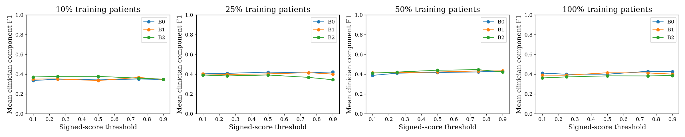
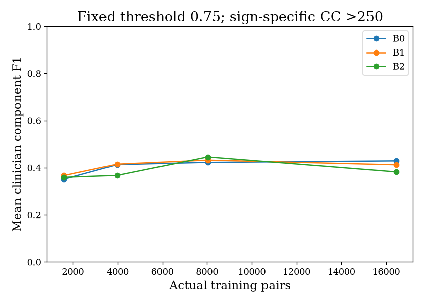

# Subset-epoch models: ICU100 OV

Exploratory reused-cohort evaluation. Checkpoints selected on synthetic validation only.
Headline: threshold 0.75 and separate-sign 8-connected CC >250 at 512x512-equivalent area.
The sweep is exploratory; no operating point is selected as a confirmatory result.
Detection F1 is not pixel Dice or historical boosted per-pair agreement.

| Model | Training patients | Best epoch | Mean F1 positive | Mean F1 negative | Mean F1 combined |
|---|---:|---:|---:|---:|---:|
| B0_fraction_0.1_seed_42 | 10% | 17 | 0.3691 | 0.3246 | 0.3511 |
| B1_fraction_0.1_seed_42 | 10% | 18 | 0.4273 | 0.2770 | 0.3668 |
| B2_fraction_0.1_seed_42 | 10% | 12 | 0.4351 | 0.2155 | 0.3592 |
| B0_fraction_0.25_seed_42 | 25% | 13 | 0.4557 | 0.3620 | 0.4130 |
| B1_fraction_0.25_seed_42 | 25% | 12 | 0.4263 | 0.4018 | 0.4151 |
| B2_fraction_0.25_seed_42 | 25% | 11 | 0.4063 | 0.3165 | 0.3674 |
| B0_fraction_0.5_seed_42 | 50% | 20 | 0.4537 | 0.3858 | 0.4226 |
| B1_fraction_0.5_seed_42 | 50% | 17 | 0.4468 | 0.4094 | 0.4321 |
| B2_fraction_0.5_seed_42 | 50% | 13 | 0.4638 | 0.4230 | 0.4457 |
| B0_fraction_1_seed_42 | 100% | 16 | 0.4306 | 0.4259 | 0.4290 |
| B1_fraction_1_seed_42 | 100% | 21 | 0.4463 | 0.3658 | 0.4122 |
| B2_fraction_1_seed_42 | 100% | 17 | 0.4231 | 0.3210 | 0.3821 |

[Exact per-reader F1](per_clinician.csv) | [Sweep table](threshold_summary.csv)

