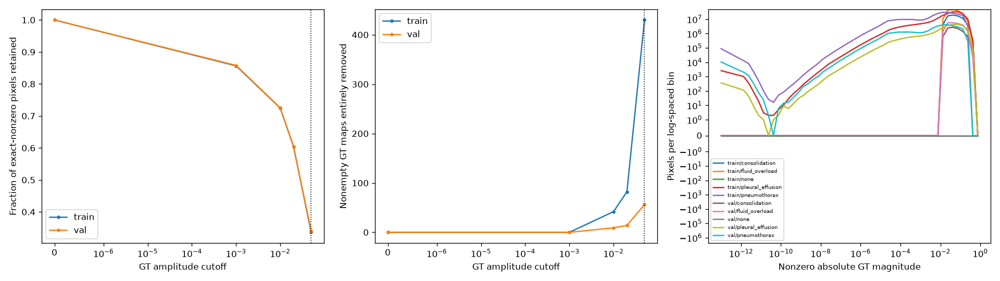

# Continuous GT Audit

Selected pairs: 18572; issues: 0.

[Summary CSV](summary.csv) | [Per-pair CSV](per_pair.csv) | [Report and histograms](report.json)

Raw means continuous transformed GT, not a sign mask. Scales on the raw-GT zoom/overlay
depend on GT alone, never prediction. Red=positive, blue=negative. Exact sign support
can include tiny numerical/interpolation tails; this report does not select a loss.

The CSV separates native arrays, training float32 preprocessing, and simulated float16.

Selected example NPZ files contain real arrays (load with allow_pickle=False), not PNG-derived values.

## Training-Space Cutoff Impact

| Split | Type | Pairs | Nonempty | Entirely removed at 0.05 | Nonzero support retained |
|---|---|---:|---:|---:|---:|
| train | overall | 16464 | 9508 | 430 | 33.627% |
| train | consolidation | 2280 | 2280 | 93 | 50.001% |
| train | fluid_overload | 2277 | 2277 | 96 | 47.203% |
| train | none | 6956 | 0 | 0 | NA |
| train | pleural_effusion | 2141 | 2141 | 108 | 37.172% |
| train | pneumothorax | 2810 | 2810 | 133 | 17.979% |
| val | overall | 2108 | 1293 | 56 | 34.088% |
| val | consolidation | 313 | 313 | 5 | 48.058% |
| val | fluid_overload | 309 | 309 | 14 | 49.676% |
| val | none | 815 | 0 | 0 | NA |
| val | pleural_effusion | 294 | 294 | 9 | 38.263% |
| val | pneumothorax | 377 | 377 | 28 | 16.695% |

## Raw GT and Signed-Mask Overlays

