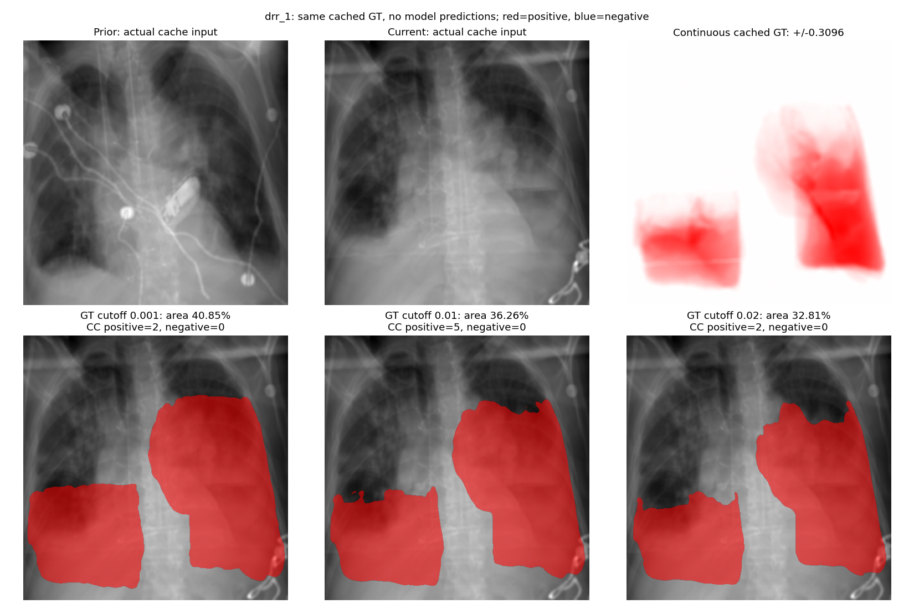
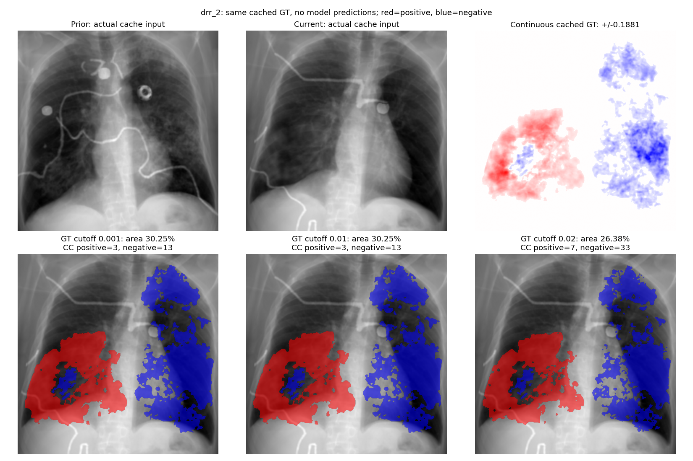
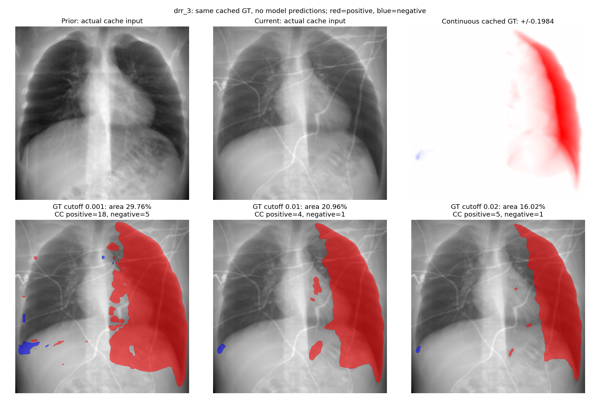

# GT Threshold Comparison

- Full-cohort measurements use saved simulated-float16 GT, not a new cache read.
- Rotation/reflection preserve pixel counts and 8-connected component topology.
- Exact examples are selected TRAIN cases, not representative cohort estimates.
- CCs are sign-separated, 8-connected; tiny means strictly fewer than 5 or 50 pixels.
- More components need not mean more changed area: a cutoff can split a component.
- All-background controls have undefined support/mass retention, not zero retention.
- Fewer pixels/components do not prove more biologically correct targets.
- No CC removal, GT normalization, model inference, training or test-split tuning.

[Full summary](summary.csv) | [Provenance and measurements](report.json)

## Full Train/Validation Retention

| Split | Cutoff | Active / originally active | Maps erased | Support retained | Absolute mass retained | Mean image area | Full-cohort CC available |
|---|---:|---:|---:|---:|---:|---:|---|
| train | 0.001 | 9508 / 9508 | 0 | 85.684% | 99.933% | 14.162% | False |
| train | 0.01 | 9466 / 9508 | 42 | 72.481% | 98.567% | 11.980% | False |
| train | 0.02 | 9426 / 9508 | 82 | 60.460% | 94.634% | 9.993% | False |
| val | 0.001 | 1293 / 1293 | 0 | 85.821% | 99.937% | 15.096% | False |
| val | 0.01 | 1284 / 1293 | 9 | 72.559% | 98.631% | 12.763% | False |
| val | 0.02 | 1279 / 1293 | 14 | 60.377% | 94.808% | 10.620% | False |

## Exact Cached Examples

[Per-example measurements](examples.csv)

| Case | Cutoff | Positive CC | Negative CC | Positive area | Negative area | CC <50px (+/-) | Pixels in CC <50px (+/-) |
|---|---:|---:|---:|---:|---:|---:|---:|
| drr_1 | 0.001 | 2 | 0 | 40.855% | 0.000% | 0 / 0 | 0 / 0 |
| drr_1 | 0.01 | 5 | 0 | 36.255% | 0.000% | 3 / 0 | 35 / 0 |
| drr_1 | 0.02 | 2 | 0 | 32.813% | 0.000% | 0 / 0 | 0 / 0 |
| drr_2 | 0.001 | 3 | 13 | 13.422% | 16.832% | 0 / 0 | 0 / 0 |
| drr_2 | 0.01 | 3 | 13 | 13.422% | 16.832% | 0 / 0 | 0 / 0 |
| drr_2 | 0.02 | 7 | 33 | 12.007% | 14.371% | 6 / 17 | 76 / 219 |
| drr_3 | 0.001 | 18 | 5 | 29.067% | 0.696% | 11 / 2 | 182 / 71 |
| drr_3 | 0.01 | 4 | 1 | 20.786% | 0.170% | 0 / 0 | 0 / 0 |
| drr_3 | 0.02 | 5 | 1 | 15.948% | 0.076% | 1 / 0 | 8 / 0 |

## drr_1

## drr_2

## drr_3

