# Val Prediction Review

Full split: 2108 pairs. Selected: 338 panels. Threshold: 0.05.

Red = positive change; blue = negative change. Heatmaps use fixed [-1,1] limits.
Additional zoom panels share the same per-case GT/prediction limits, printed in their titles.
Overlays show signed thresholded masks on the current image, not attention weights.
Source images use the same resizing and per-image normalization as the dataset loader.
Selection is enriched for failures and successes, not a representative performance estimate.
See report JSON for full-split metrics, CSV for every pair, and review_metadata.json for provenance.

## consolidation/below_threshold

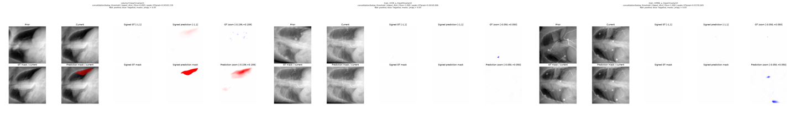

- [c55f1863afae64c4](cases/c55f1863afae64c4.png): lowest_dice, Dice 0.000
- [861fb8455f5c0b29](cases/861fb8455f5c0b29.png): lowest_dice, Dice 1.000
- [3ab19d90c3539ea4](cases/3ab19d90c3539ea4.png): lowest_dice, Dice 1.000

## consolidation/mixed

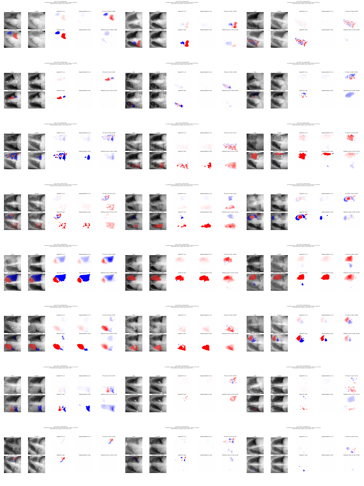

- [a714fc6ce8ac9c40](cases/a714fc6ce8ac9c40.png): lowest_dice, Dice 0.000
- [4f423856d7e10841](cases/4f423856d7e10841.png): lowest_dice, Dice 0.000
- [6add47908a9baf9b](cases/6add47908a9baf9b.png): lowest_dice, Dice 0.000
- [1bced3ebacadbd93](cases/1bced3ebacadbd93.png): lowest_dice, Dice 0.000
- [bbc2ae99c05ab107](cases/bbc2ae99c05ab107.png): lowest_dice, Dice 0.000
- [da64d2bc5f0d5906](cases/da64d2bc5f0d5906.png): lowest_dice, Dice 0.000
- [6eefdf7b029db665](cases/6eefdf7b029db665.png): middle_dice, Dice 0.391
- [89c5dfa2f872cd49](cases/89c5dfa2f872cd49.png): middle_dice, Dice 0.392
- [4aac958e9747a276](cases/4aac958e9747a276.png): middle_dice, Dice 0.420
- [8caf2a1f727dfc8e](cases/8caf2a1f727dfc8e.png): middle_dice, Dice 0.432
- [59c7c6fd717ffd6b](cases/59c7c6fd717ffd6b.png): middle_dice, Dice 0.446
- [83b6196883d30886](cases/83b6196883d30886.png): middle_dice, Dice 0.317
- [6718ecdad79a33e2](cases/6718ecdad79a33e2.png): highest_dice, Dice 0.898
- [252b3bc28b3154fc](cases/252b3bc28b3154fc.png): highest_dice, Dice 0.865
- [c497d5700d633a53](cases/c497d5700d633a53.png): highest_dice, Dice 0.842
- [eb52ab440ddda0a3](cases/eb52ab440ddda0a3.png): highest_dice, Dice 0.839
- [594fd3b7a0ed5f42](cases/594fd3b7a0ed5f42.png): highest_dice, Dice 0.818
- [930f8b0e894992ca](cases/930f8b0e894992ca.png): highest_dice, Dice 0.718
- [f7b030fc0c8c0081](cases/f7b030fc0c8c0081.png): seeded_random, Dice 0.499
- [7dc0090525030a71](cases/7dc0090525030a71.png): seeded_random, Dice 0.000
- [5e1081bb8683b035](cases/5e1081bb8683b035.png): seeded_random, Dice 0.000
- [b0060134971714c9](cases/b0060134971714c9.png): seeded_random, Dice 0.000
- [9755022ea0fb330f](cases/9755022ea0fb330f.png): seeded_random, Dice 0.000
- [cd9a7a44b566fd2f](cases/cd9a7a44b566fd2f.png): seeded_random, Dice 0.000

## consolidation/negative

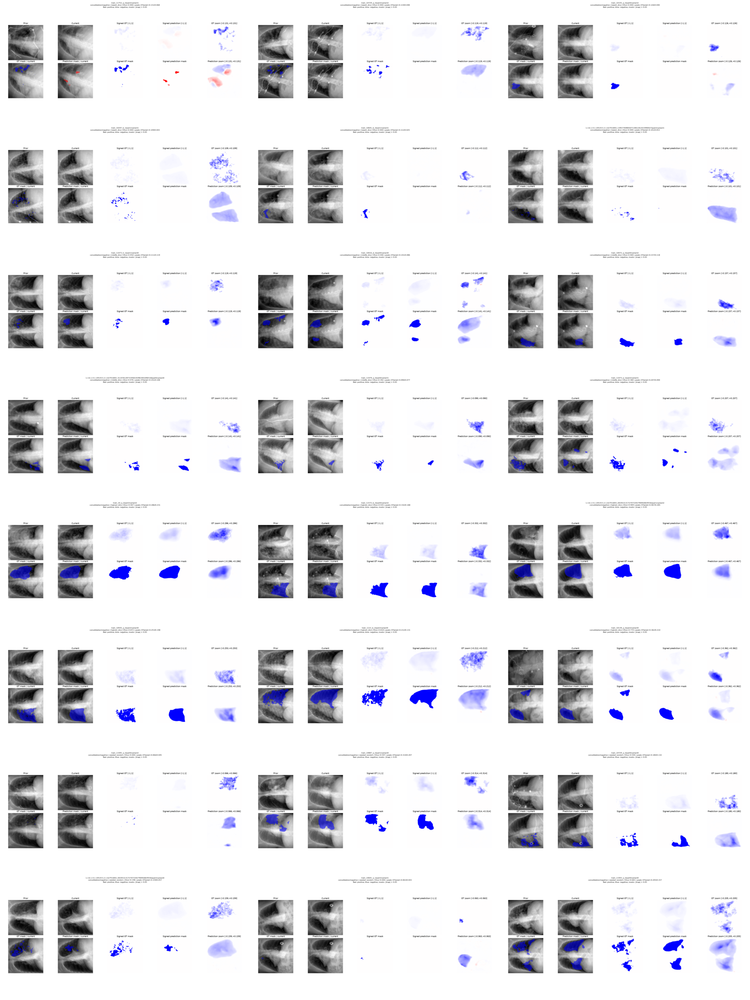

- [f0aaab57f1dbf957](cases/f0aaab57f1dbf957.png): lowest_dice, Dice 0.000
- [510270a60ba1234e](cases/510270a60ba1234e.png): lowest_dice, Dice 0.000
- [8fae71161afa7f01](cases/8fae71161afa7f01.png): lowest_dice, Dice 0.000
- [4c8d79ce357e8661](cases/4c8d79ce357e8661.png): lowest_dice, Dice 0.000
- [592074529e6e1328](cases/592074529e6e1328.png): lowest_dice, Dice 0.000
- [3e7815cd0120fe9f](cases/3e7815cd0120fe9f.png): lowest_dice, Dice 0.000
- [a1e9e91220d4c7b5](cases/a1e9e91220d4c7b5.png): middle_dice, Dice 0.454
- [94588789279ffa56](cases/94588789279ffa56.png): middle_dice, Dice 0.440
- [f3c186bf875e93d6](cases/f3c186bf875e93d6.png): middle_dice, Dice 0.469
- [2fa356c4139df744](cases/2fa356c4139df744.png): middle_dice, Dice 0.476
- [d2ae9c96b392fe9d](cases/d2ae9c96b392fe9d.png): middle_dice, Dice 0.392
- [6274befeaa3441f9](cases/6274befeaa3441f9.png): middle_dice, Dice 0.384
- [d96dee84e1a18d8d](cases/d96dee84e1a18d8d.png): highest_dice, Dice 0.947
- [474eb00a39593f68](cases/474eb00a39593f68.png): highest_dice, Dice 0.935
- [8806fbcd1cca6957](cases/8806fbcd1cca6957.png): highest_dice, Dice 0.909
- [99dd4d70edd40570](cases/99dd4d70edd40570.png): highest_dice, Dice 0.872
- [0a27c09407022906](cases/0a27c09407022906.png): highest_dice, Dice 0.818
- [70750025776fd953](cases/70750025776fd953.png): highest_dice, Dice 0.774
- [023688b8ca66224d](cases/023688b8ca66224d.png): seeded_random, Dice 0.000
- [8c9bbbf86a67298e](cases/8c9bbbf86a67298e.png): seeded_random, Dice 0.597
- [d82ab3a93fa42a81](cases/d82ab3a93fa42a81.png): seeded_random, Dice 0.594
- [433877a46c973123](cases/433877a46c973123.png): seeded_random, Dice 0.198
- [53ba38c32c2a340d](cases/53ba38c32c2a340d.png): seeded_random, Dice 0.000
- [f0a9d0f07d85fd6a](cases/f0a9d0f07d85fd6a.png): seeded_random, Dice 0.683

## consolidation/positive

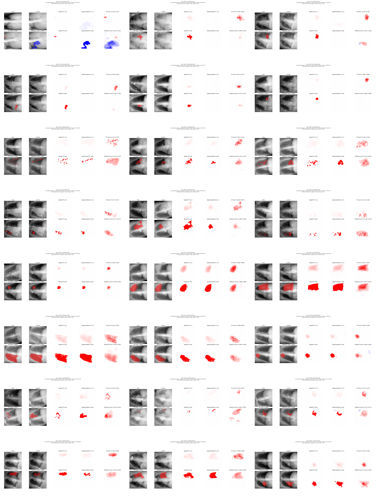

- [4a23dfdd789c2307](cases/4a23dfdd789c2307.png): lowest_dice, Dice 0.000
- [1b3437721a1dcb7f](cases/1b3437721a1dcb7f.png): lowest_dice, Dice 0.000
- [94f1c03858bf06e9](cases/94f1c03858bf06e9.png): lowest_dice, Dice 0.000
- [2a00aa6b0d51f154](cases/2a00aa6b0d51f154.png): lowest_dice, Dice 0.000
- [9fba925428676db9](cases/9fba925428676db9.png): lowest_dice, Dice 0.000
- [43ed9f89551ddb1f](cases/43ed9f89551ddb1f.png): lowest_dice, Dice 0.000
- [b024eb8c57fc3471](cases/b024eb8c57fc3471.png): middle_dice, Dice 0.503
- [abd371b8b6a476d6](cases/abd371b8b6a476d6.png): middle_dice, Dice 0.498
- [dfe04d5caadb963f](cases/dfe04d5caadb963f.png): middle_dice, Dice 0.477
- [c9b80db97bfe36e2](cases/c9b80db97bfe36e2.png): middle_dice, Dice 0.533
- [cc32408cd2eceab8](cases/cc32408cd2eceab8.png): middle_dice, Dice 0.467
- [abba53ae33523c83](cases/abba53ae33523c83.png): middle_dice, Dice 0.540
- [c6ac373d4384e026](cases/c6ac373d4384e026.png): highest_dice, Dice 0.942
- [a05ddf43a8eafda2](cases/a05ddf43a8eafda2.png): highest_dice, Dice 0.939
- [0c1aea4820370905](cases/0c1aea4820370905.png): highest_dice, Dice 0.927
- [cf512ba90e86c64a](cases/cf512ba90e86c64a.png): highest_dice, Dice 0.921
- [512aa805db6ac87a](cases/512aa805db6ac87a.png): highest_dice, Dice 0.916
- [ca0b6151c9630fdf](cases/ca0b6151c9630fdf.png): highest_dice, Dice 0.915
- [bae7f4ea9e8627e1](cases/bae7f4ea9e8627e1.png): seeded_random, Dice 0.300
- [3f8976331723226d](cases/3f8976331723226d.png): seeded_random, Dice 0.032
- [8811cc08a4f44faa](cases/8811cc08a4f44faa.png): seeded_random, Dice 0.672
- [5be7c54e1e6d6dd7](cases/5be7c54e1e6d6dd7.png): seeded_random, Dice 0.591
- [8628182d03fec52d](cases/8628182d03fec52d.png): seeded_random, Dice 0.691
- [11358ab53920bead](cases/11358ab53920bead.png): seeded_random, Dice 0.719

## fluid_overload/below_threshold

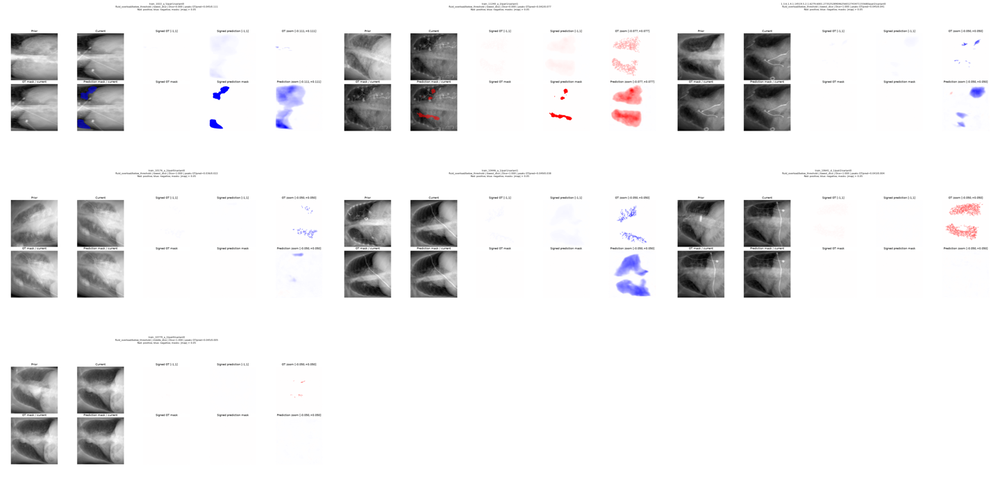

- [fc19ec977abec760](cases/fc19ec977abec760.png): lowest_dice, Dice 0.000
- [8321dcc2ce0b57ed](cases/8321dcc2ce0b57ed.png): lowest_dice, Dice 0.000
- [da99dc758d5f40ec](cases/da99dc758d5f40ec.png): lowest_dice, Dice 1.000
- [a4ab958cc611a58c](cases/a4ab958cc611a58c.png): lowest_dice, Dice 1.000
- [acf732762c428a34](cases/acf732762c428a34.png): lowest_dice, Dice 1.000
- [16f433c160a39bf6](cases/16f433c160a39bf6.png): lowest_dice, Dice 1.000
- [08c64f3448ee8dfd](cases/08c64f3448ee8dfd.png): middle_dice, Dice 1.000

## fluid_overload/mixed

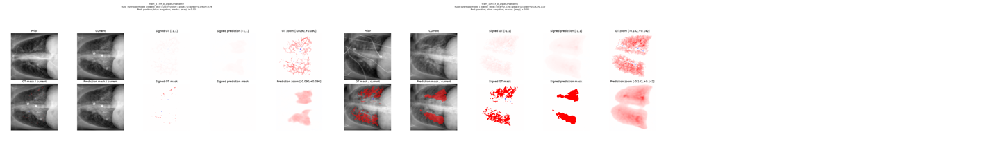

- [8a5c70e582310aed](cases/8a5c70e582310aed.png): lowest_dice, Dice 0.000
- [8505b15ba918c87a](cases/8505b15ba918c87a.png): lowest_dice, Dice 0.516

## fluid_overload/negative

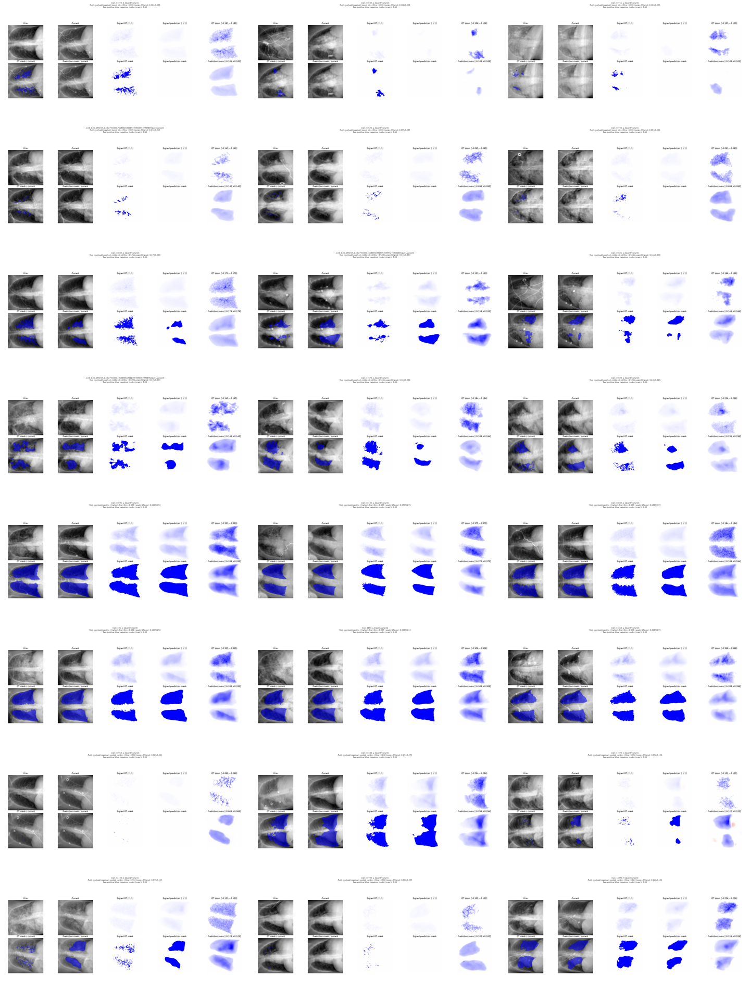

- [abaf17cd83edf328](cases/abaf17cd83edf328.png): lowest_dice, Dice 0.000
- [7fd64224187f2a4f](cases/7fd64224187f2a4f.png): lowest_dice, Dice 0.000
- [86b83b6c8265755b](cases/86b83b6c8265755b.png): lowest_dice, Dice 0.000
- [44a53de40b0f160c](cases/44a53de40b0f160c.png): lowest_dice, Dice 0.000
- [a957783f992f819a](cases/a957783f992f819a.png): lowest_dice, Dice 0.000
- [9e43a6d8ccf76ab0](cases/9e43a6d8ccf76ab0.png): lowest_dice, Dice 0.000
- [3a0e75578daf0975](cases/3a0e75578daf0975.png): middle_dice, Dice 0.576
- [9b482a79690a32f2](cases/9b482a79690a32f2.png): middle_dice, Dice 0.580
- [86bc137f8b6623bd](cases/86bc137f8b6623bd.png): middle_dice, Dice 0.568
- [4f2431b1f3945329](cases/4f2431b1f3945329.png): middle_dice, Dice 0.589
- [153f403a42fa51b7](cases/153f403a42fa51b7.png): middle_dice, Dice 0.563
- [a35123a4eb38a9a7](cases/a35123a4eb38a9a7.png): middle_dice, Dice 0.599
- [16f012c768092142](cases/16f012c768092142.png): highest_dice, Dice 0.936
- [c5a771a8805a1186](cases/c5a771a8805a1186.png): highest_dice, Dice 0.933
- [898b446d5b629897](cases/898b446d5b629897.png): highest_dice, Dice 0.933
- [fae7f28ab786eaaa](cases/fae7f28ab786eaaa.png): highest_dice, Dice 0.931
- [8a747770818a75a8](cases/8a747770818a75a8.png): highest_dice, Dice 0.929
- [faf6baf044a62128](cases/faf6baf044a62128.png): highest_dice, Dice 0.920
- [0e766a81d92935fb](cases/0e766a81d92935fb.png): seeded_random, Dice 0.000
- [afd5e0a7e7c55a3b](cases/afd5e0a7e7c55a3b.png): seeded_random, Dice 0.830
- [e6ff72dd48ca47a9](cases/e6ff72dd48ca47a9.png): seeded_random, Dice 0.166
- [baa3f36bfbf17a79](cases/baa3f36bfbf17a79.png): seeded_random, Dice 0.331
- [d382aba1a12be81a](cases/d382aba1a12be81a.png): seeded_random, Dice 0.000
- [fe50ed09fd09b172](cases/fe50ed09fd09b172.png): seeded_random, Dice 0.824

## fluid_overload/positive

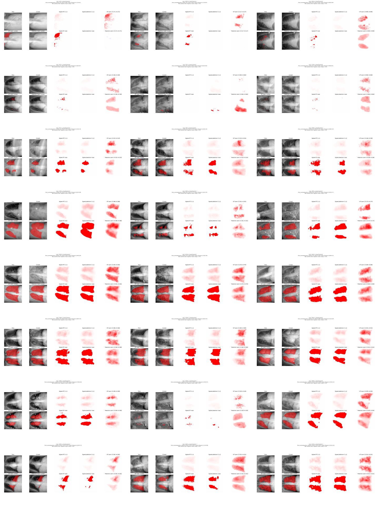

- [ec52ee0ddb392467](cases/ec52ee0ddb392467.png): lowest_dice, Dice 0.000
- [4c2d902e70c09ca2](cases/4c2d902e70c09ca2.png): lowest_dice, Dice 0.000
- [62fbc342dbe4a7d7](cases/62fbc342dbe4a7d7.png): lowest_dice, Dice 0.000
- [d8162dc0020266a3](cases/d8162dc0020266a3.png): lowest_dice, Dice 0.000
- [09a006e3d5b77583](cases/09a006e3d5b77583.png): lowest_dice, Dice 0.000
- [1b81e43e7786a3cd](cases/1b81e43e7786a3cd.png): lowest_dice, Dice 0.000
- [c603b2125d9df931](cases/c603b2125d9df931.png): middle_dice, Dice 0.740
- [f0df3c46db08f4e8](cases/f0df3c46db08f4e8.png): middle_dice, Dice 0.745
- [83b6555a786818c4](cases/83b6555a786818c4.png): middle_dice, Dice 0.721
- [d65acbf63586b3ad](cases/d65acbf63586b3ad.png): middle_dice, Dice 0.763
- [ee341a6048597cfd](cases/ee341a6048597cfd.png): middle_dice, Dice 0.715
- [429cebfa51f9f5f7](cases/429cebfa51f9f5f7.png): middle_dice, Dice 0.767
- [f90aa7f118002274](cases/f90aa7f118002274.png): highest_dice, Dice 0.949
- [0f0f4fa53cae0856](cases/0f0f4fa53cae0856.png): highest_dice, Dice 0.940
- [a61629c55c79badb](cases/a61629c55c79badb.png): highest_dice, Dice 0.928
- [aa54350c00575dd0](cases/aa54350c00575dd0.png): highest_dice, Dice 0.915
- [01eb9198ae8cfad1](cases/01eb9198ae8cfad1.png): highest_dice, Dice 0.914
- [e0dadf973f40efc5](cases/e0dadf973f40efc5.png): highest_dice, Dice 0.898
- [b1a4998ba94832e5](cases/b1a4998ba94832e5.png): seeded_random, Dice 0.806
- [141823e60d497810](cases/141823e60d497810.png): seeded_random, Dice 0.188
- [eb6caa89180fa3ad](cases/eb6caa89180fa3ad.png): seeded_random, Dice 0.848
- [80b62b0c754ffd0d](cases/80b62b0c754ffd0d.png): seeded_random, Dice 0.676
- [d846ec3c1fa4bbcd](cases/d846ec3c1fa4bbcd.png): seeded_random, Dice 0.693
- [35132375c1f9256f](cases/35132375c1f9256f.png): seeded_random, Dice 0.897

## nuisance

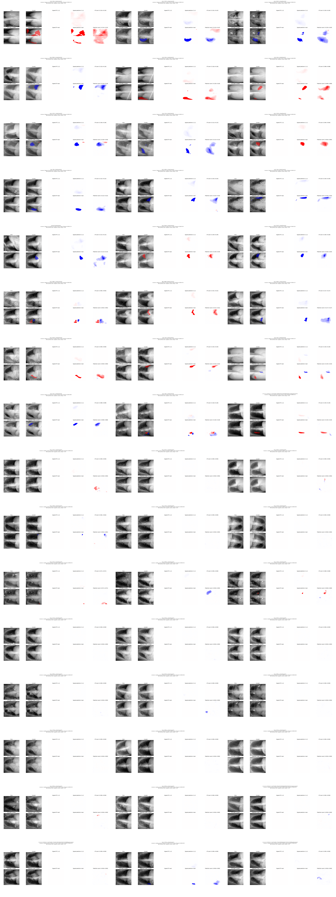

- [0d66731b9434938a](cases/0d66731b9434938a.png): highest_fp, FP 0.1740
- [29eb5a9714201de5](cases/29eb5a9714201de5.png): highest_fp, FP 0.0678
- [ce99382ad3941c87](cases/ce99382ad3941c87.png): highest_fp, FP 0.0631
- [5c3743553dc90c50](cases/5c3743553dc90c50.png): highest_fp, FP 0.0605
- [d3fda8562cb4251b](cases/d3fda8562cb4251b.png): highest_fp, FP 0.0603
- [15fcf2451133bb14](cases/15fcf2451133bb14.png): highest_fp, FP 0.0547
- [4550d1e07df11313](cases/4550d1e07df11313.png): highest_fp, FP 0.0500
- [35ebf53d85d0564b](cases/35ebf53d85d0564b.png): highest_fp, FP 0.0479
- [51d6564e77decba5](cases/51d6564e77decba5.png): highest_fp, FP 0.0448
- [5d22cf4f1ff93d8d](cases/5d22cf4f1ff93d8d.png): highest_fp, FP 0.0413
- [30521d38573cb78a](cases/30521d38573cb78a.png): highest_fp, FP 0.0393
- [5c7c8507aadfbb50](cases/5c7c8507aadfbb50.png): highest_fp, FP 0.0361
- [6dcf209510cdcfc4](cases/6dcf209510cdcfc4.png): highest_fp, FP 0.0359
- [576b15734eb59020](cases/576b15734eb59020.png): highest_fp, FP 0.0337
- [c7fa20db50e9f98d](cases/c7fa20db50e9f98d.png): highest_fp, FP 0.0311
- [7164b6f6bee113aa](cases/7164b6f6bee113aa.png): highest_fp, FP 0.0300
- [6de75c3ad005831b](cases/6de75c3ad005831b.png): highest_fp, FP 0.0290
- [653e4b0cc0f27f4a](cases/653e4b0cc0f27f4a.png): highest_fp, FP 0.0268
- [fb929e09e9c28a58](cases/fb929e09e9c28a58.png): highest_fp, FP 0.0267
- [f5bc91f18451d452](cases/f5bc91f18451d452.png): highest_fp, FP 0.0262
- [ce4e32ff5f729361](cases/ce4e32ff5f729361.png): highest_fp, FP 0.0259
- [60afbabc4aabbe92](cases/60afbabc4aabbe92.png): highest_fp, FP 0.0248
- [7dccf8e47ff5600a](cases/7dccf8e47ff5600a.png): highest_fp, FP 0.0247
- [5511b9ca8e54e32c](cases/5511b9ca8e54e32c.png): highest_fp, FP 0.0216
- [e376d93a8b89e32b](cases/e376d93a8b89e32b.png): seeded_random, FP 0.0000
- [e61a9a80b7652589](cases/e61a9a80b7652589.png): seeded_random, FP 0.0000
- [bcad7631ac350b14](cases/bcad7631ac350b14.png): seeded_random, FP 0.0000
- [92bbfaa8cf6c05fa](cases/92bbfaa8cf6c05fa.png): seeded_random, FP 0.0035
- [0b838dd096d052fd](cases/0b838dd096d052fd.png): seeded_random, FP 0.0000
- [4d9c2c1f60954f68](cases/4d9c2c1f60954f68.png): seeded_random, FP 0.0000
- [22b324b57168ffe0](cases/22b324b57168ffe0.png): seeded_random, FP 0.0020
- [702a1d9795257e7e](cases/702a1d9795257e7e.png): seeded_random, FP 0.0000
- [36d95d79d6c149f1](cases/36d95d79d6c149f1.png): seeded_random, FP 0.0042
- [172e5adb5480f346](cases/172e5adb5480f346.png): seeded_random, FP 0.0000
- [c7822e013615389e](cases/c7822e013615389e.png): seeded_random, FP 0.0000
- [104214d76d34c901](cases/104214d76d34c901.png): seeded_random, FP 0.0000
- [73ac55a4b2ae85cf](cases/73ac55a4b2ae85cf.png): seeded_random, FP 0.0000
- [6ab03558712814a0](cases/6ab03558712814a0.png): seeded_random, FP 0.0000
- [f8372662070f6358](cases/f8372662070f6358.png): seeded_random, FP 0.0000
- [2e47de8af1584470](cases/2e47de8af1584470.png): seeded_random, FP 0.0000
- [bf5c5cb495777e9a](cases/bf5c5cb495777e9a.png): seeded_random, FP 0.0000
- [51c56b34954fa3e0](cases/51c56b34954fa3e0.png): seeded_random, FP 0.0000
- [7ac2f1856b982fc2](cases/7ac2f1856b982fc2.png): seeded_random, FP 0.0000
- [e235eab27fbfbb0e](cases/e235eab27fbfbb0e.png): seeded_random, FP 0.0000
- [7459ca6c5a3b00e9](cases/7459ca6c5a3b00e9.png): seeded_random, FP 0.0000
- [1480948c76eb3680](cases/1480948c76eb3680.png): seeded_random, FP 0.0000
- [f262b900c803b4d7](cases/f262b900c803b4d7.png): seeded_random, FP 0.0114
- [2e2a5d83e0893b21](cases/2e2a5d83e0893b21.png): seeded_random, FP 0.0000

## pleural_effusion/below_threshold

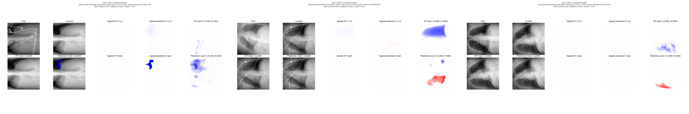

- [509a87438eafa43b](cases/509a87438eafa43b.png): lowest_dice, Dice 0.000
- [d24fd5d7e21c52f1](cases/d24fd5d7e21c52f1.png): lowest_dice, Dice 0.000
- [87ec83507387c21d](cases/87ec83507387c21d.png): lowest_dice, Dice 1.000

## pleural_effusion/mixed

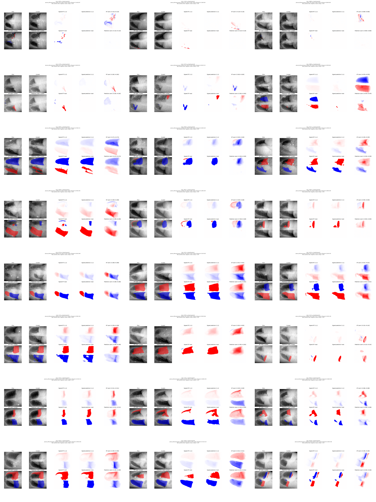

- [229098901eb4449a](cases/229098901eb4449a.png): lowest_dice, Dice 0.000
- [8d03cbfd231a0e6f](cases/8d03cbfd231a0e6f.png): lowest_dice, Dice 0.000
- [1a05b623f82c90f2](cases/1a05b623f82c90f2.png): lowest_dice, Dice 0.000
- [c022c5a12cd105b1](cases/c022c5a12cd105b1.png): lowest_dice, Dice 0.003
- [0bb99a810d41c6fa](cases/0bb99a810d41c6fa.png): lowest_dice, Dice 0.028
- [830c142a47c6f7cf](cases/830c142a47c6f7cf.png): lowest_dice, Dice 0.036
- [e11ce1e64e2b63fb](cases/e11ce1e64e2b63fb.png): middle_dice, Dice 0.790
- [72ecb4cca82f0aa9](cases/72ecb4cca82f0aa9.png): middle_dice, Dice 0.800
- [a0724e733d6ccf9f](cases/a0724e733d6ccf9f.png): middle_dice, Dice 0.802
- [7b5560facc6a3677](cases/7b5560facc6a3677.png): middle_dice, Dice 0.805
- [0381048513f55618](cases/0381048513f55618.png): middle_dice, Dice 0.806
- [7c3f11ce5d9b1569](cases/7c3f11ce5d9b1569.png): middle_dice, Dice 0.808
- [f72a2571afd9b0a1](cases/f72a2571afd9b0a1.png): highest_dice, Dice 0.928
- [00b362f2cfcd62b6](cases/00b362f2cfcd62b6.png): highest_dice, Dice 0.924
- [ff519471a149073c](cases/ff519471a149073c.png): highest_dice, Dice 0.919
- [ba818b29fdac5abf](cases/ba818b29fdac5abf.png): highest_dice, Dice 0.911
- [3dec73ef47204d5e](cases/3dec73ef47204d5e.png): highest_dice, Dice 0.895
- [b2faec6bb3eb0f35](cases/b2faec6bb3eb0f35.png): highest_dice, Dice 0.871
- [5ae197011e7e5292](cases/5ae197011e7e5292.png): seeded_random, Dice 0.862
- [1a3293a120eec928](cases/1a3293a120eec928.png): seeded_random, Dice 0.748
- [2b65bbc07bbb31b3](cases/2b65bbc07bbb31b3.png): seeded_random, Dice 0.741
- [ac16adcd359e4bbc](cases/ac16adcd359e4bbc.png): seeded_random, Dice 0.843
- [4f8f0298ee42467f](cases/4f8f0298ee42467f.png): seeded_random, Dice 0.754
- [f2a5d94506306254](cases/f2a5d94506306254.png): seeded_random, Dice 0.703

## pleural_effusion/negative

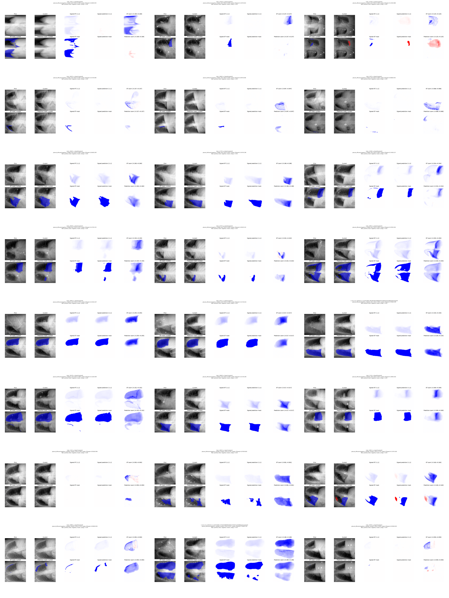

- [584570d6fb029072](cases/584570d6fb029072.png): lowest_dice, Dice 0.000
- [42840d0d89db48cc](cases/42840d0d89db48cc.png): lowest_dice, Dice 0.000
- [c3ba7b0f98711fec](cases/c3ba7b0f98711fec.png): lowest_dice, Dice 0.000
- [d1d08d1466da6f1a](cases/d1d08d1466da6f1a.png): lowest_dice, Dice 0.000
- [e4fd7bae6516d8f2](cases/e4fd7bae6516d8f2.png): lowest_dice, Dice 0.000
- [f3077baa516f34c8](cases/f3077baa516f34c8.png): lowest_dice, Dice 0.000
- [2592b0f9494a9d3a](cases/2592b0f9494a9d3a.png): middle_dice, Dice 0.806
- [defecac2440ef643](cases/defecac2440ef643.png): middle_dice, Dice 0.803
- [2139ea11205d1d2f](cases/2139ea11205d1d2f.png): middle_dice, Dice 0.802
- [4793e3393b8732a3](cases/4793e3393b8732a3.png): middle_dice, Dice 0.812
- [0124b4b668c7c86c](cases/0124b4b668c7c86c.png): middle_dice, Dice 0.800
- [30a7037fb43c337f](cases/30a7037fb43c337f.png): middle_dice, Dice 0.800
- [ce63e745db6c39dc](cases/ce63e745db6c39dc.png): highest_dice, Dice 0.970
- [032d73d292c42eb6](cases/032d73d292c42eb6.png): highest_dice, Dice 0.968
- [b21627bb60b74521](cases/b21627bb60b74521.png): highest_dice, Dice 0.962
- [3af541f35f3372ca](cases/3af541f35f3372ca.png): highest_dice, Dice 0.960
- [c0b79bf36fbd7a29](cases/c0b79bf36fbd7a29.png): highest_dice, Dice 0.960
- [ed2a0670bb8a0514](cases/ed2a0670bb8a0514.png): highest_dice, Dice 0.953
- [862a054e76de9809](cases/862a054e76de9809.png): seeded_random, Dice 0.000
- [7bfdd75204f78981](cases/7bfdd75204f78981.png): seeded_random, Dice 0.545
- [c638ea6b007d7424](cases/c638ea6b007d7424.png): seeded_random, Dice 0.716
- [455809fbd8c1003a](cases/455809fbd8c1003a.png): seeded_random, Dice 0.239
- [0c040a3781bf2f41](cases/0c040a3781bf2f41.png): seeded_random, Dice 0.621
- [5bac2e234ad033d0](cases/5bac2e234ad033d0.png): seeded_random, Dice 0.000

## pleural_effusion/positive

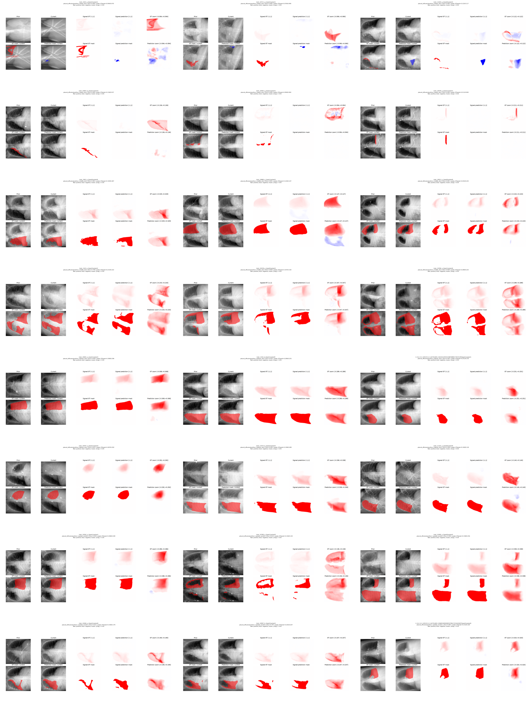

- [889777567cabedf7](cases/889777567cabedf7.png): lowest_dice, Dice 0.000
- [db249e85d5e868a9](cases/db249e85d5e868a9.png): lowest_dice, Dice 0.000
- [2cf627f1b0ad43ea](cases/2cf627f1b0ad43ea.png): lowest_dice, Dice 0.000
- [8d2ddc19a5e31d0b](cases/8d2ddc19a5e31d0b.png): lowest_dice, Dice 0.000
- [9ab8ceffcc7f229c](cases/9ab8ceffcc7f229c.png): lowest_dice, Dice 0.000
- [ac39aabf03af77ad](cases/ac39aabf03af77ad.png): lowest_dice, Dice 0.000
- [fec14c8aca704880](cases/fec14c8aca704880.png): middle_dice, Dice 0.801
- [7c45b2ec94651167](cases/7c45b2ec94651167.png): middle_dice, Dice 0.801
- [6b9dd507b93b485e](cases/6b9dd507b93b485e.png): middle_dice, Dice 0.801
- [b199f65ba45d011e](cases/b199f65ba45d011e.png): middle_dice, Dice 0.799
- [4b1798110676ffdf](cases/4b1798110676ffdf.png): middle_dice, Dice 0.804
- [920b59e31abe9707](cases/920b59e31abe9707.png): middle_dice, Dice 0.804
- [8f20145038dbb5ef](cases/8f20145038dbb5ef.png): highest_dice, Dice 0.956
- [f92cb469aaf32182](cases/f92cb469aaf32182.png): highest_dice, Dice 0.952
- [67aa8059e44b967c](cases/67aa8059e44b967c.png): highest_dice, Dice 0.947
- [3307ecedad9afcae](cases/3307ecedad9afcae.png): highest_dice, Dice 0.947
- [4ea581cf47dc4d5c](cases/4ea581cf47dc4d5c.png): highest_dice, Dice 0.945
- [4a42b7b9f70814ae](cases/4a42b7b9f70814ae.png): highest_dice, Dice 0.944
- [7b680d4c8b6c43f4](cases/7b680d4c8b6c43f4.png): seeded_random, Dice 0.924
- [a9711e8445b00e7f](cases/a9711e8445b00e7f.png): seeded_random, Dice 0.612
- [3a81b013d9e107e1](cases/3a81b013d9e107e1.png): seeded_random, Dice 0.942
- [72ec64befa88902c](cases/72ec64befa88902c.png): seeded_random, Dice 0.621
- [3988fe3c0008fd0e](cases/3988fe3c0008fd0e.png): seeded_random, Dice 0.797
- [6ea40a036d82131a](cases/6ea40a036d82131a.png): seeded_random, Dice 0.867

## pneumothorax/below_threshold

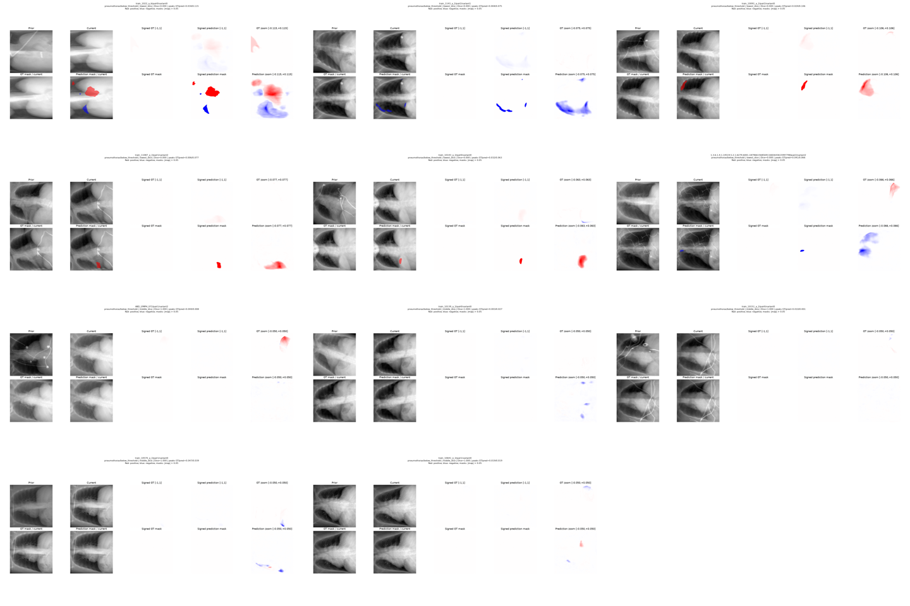

- [faf9e7e27c1704ca](cases/faf9e7e27c1704ca.png): lowest_dice, Dice 0.000
- [942d40fe151273ae](cases/942d40fe151273ae.png): lowest_dice, Dice 0.000
- [df11e5883d2df253](cases/df11e5883d2df253.png): lowest_dice, Dice 0.000
- [a9a8904e4788174e](cases/a9a8904e4788174e.png): lowest_dice, Dice 0.000
- [685a51620225800d](cases/685a51620225800d.png): lowest_dice, Dice 0.000
- [31d4d3265d912d26](cases/31d4d3265d912d26.png): lowest_dice, Dice 0.000
- [79b46b06fc29053a](cases/79b46b06fc29053a.png): middle_dice, Dice 1.000
- [57cc318e1e1721e5](cases/57cc318e1e1721e5.png): middle_dice, Dice 1.000
- [92a0fbbc9960290e](cases/92a0fbbc9960290e.png): middle_dice, Dice 1.000
- [8686cfef676371d5](cases/8686cfef676371d5.png): middle_dice, Dice 1.000
- [c808bd780f28a689](cases/c808bd780f28a689.png): middle_dice, Dice 1.000

## pneumothorax/mixed

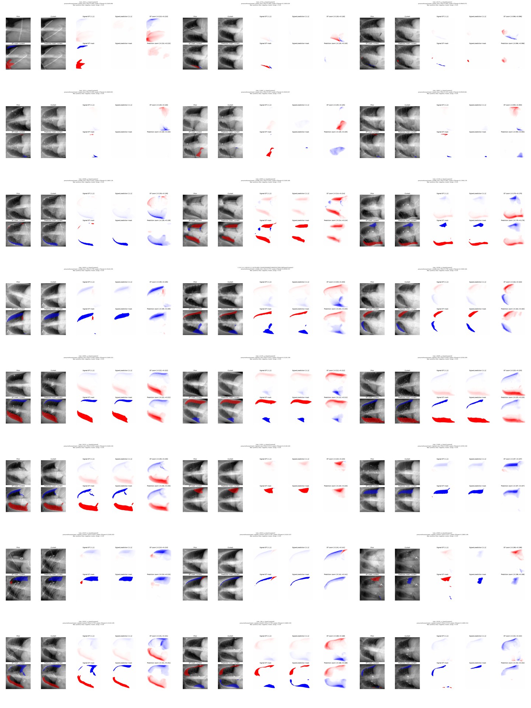

- [755dd28b383c02b7](cases/755dd28b383c02b7.png): lowest_dice, Dice 0.000
- [4fc630321c26fc24](cases/4fc630321c26fc24.png): lowest_dice, Dice 0.000
- [000497bb9421e376](cases/000497bb9421e376.png): lowest_dice, Dice 0.000
- [aeba4cdedb2b1b62](cases/aeba4cdedb2b1b62.png): lowest_dice, Dice 0.000
- [f28e7bb29725cfcb](cases/f28e7bb29725cfcb.png): lowest_dice, Dice 0.047
- [eb05b6d6a5370403](cases/eb05b6d6a5370403.png): lowest_dice, Dice 0.103
- [1c2fc63cbdc77d10](cases/1c2fc63cbdc77d10.png): middle_dice, Dice 0.810
- [9da8c19174762982](cases/9da8c19174762982.png): middle_dice, Dice 0.816
- [038926bd89d518e4](cases/038926bd89d518e4.png): middle_dice, Dice 0.802
- [08340675d418881e](cases/08340675d418881e.png): middle_dice, Dice 0.799
- [cfb9e7861b69e43b](cases/cfb9e7861b69e43b.png): middle_dice, Dice 0.797
- [f6e3648da53d3ce6](cases/f6e3648da53d3ce6.png): middle_dice, Dice 0.796
- [da72279c12ad37ff](cases/da72279c12ad37ff.png): highest_dice, Dice 0.938
- [c241a2fee8e54b62](cases/c241a2fee8e54b62.png): highest_dice, Dice 0.931
- [fd42aefa2edf04b7](cases/fd42aefa2edf04b7.png): highest_dice, Dice 0.928
- [db8866dd8e0f10ff](cases/db8866dd8e0f10ff.png): highest_dice, Dice 0.920
- [e02cf0cfcfe975ba](cases/e02cf0cfcfe975ba.png): highest_dice, Dice 0.913
- [848ccd0845214818](cases/848ccd0845214818.png): highest_dice, Dice 0.909
- [791c37a7fb48cff9](cases/791c37a7fb48cff9.png): seeded_random, Dice 0.870
- [cb6f8eaf67951503](cases/cb6f8eaf67951503.png): seeded_random, Dice 0.795
- [8b0c8c0d7fe5cdae](cases/8b0c8c0d7fe5cdae.png): seeded_random, Dice 0.471
- [ff5570e7b00ffd5f](cases/ff5570e7b00ffd5f.png): seeded_random, Dice 0.759
- [4da1e8697841b0dd](cases/4da1e8697841b0dd.png): seeded_random, Dice 0.749
- [08e909cd2200e218](cases/08e909cd2200e218.png): seeded_random, Dice 0.514

## pneumothorax/negative

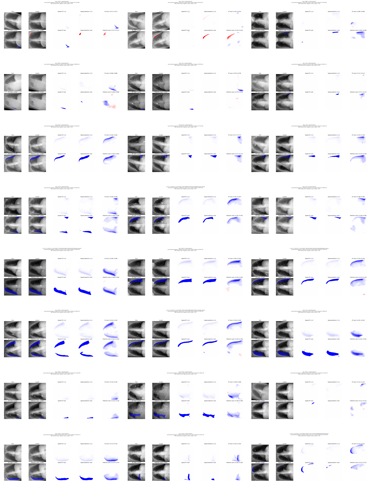

- [b60b6ca1d72a1340](cases/b60b6ca1d72a1340.png): lowest_dice, Dice 0.000
- [904694b8f05865eb](cases/904694b8f05865eb.png): lowest_dice, Dice 0.000
- [31c878a6025bec6a](cases/31c878a6025bec6a.png): lowest_dice, Dice 0.000
- [b7bf001b77f2001e](cases/b7bf001b77f2001e.png): lowest_dice, Dice 0.000
- [1dbcb33b9e517154](cases/1dbcb33b9e517154.png): lowest_dice, Dice 0.000
- [e84ae9abc0021614](cases/e84ae9abc0021614.png): lowest_dice, Dice 0.000
- [5e29f72209bf4237](cases/5e29f72209bf4237.png): middle_dice, Dice 0.740
- [7a381d8a6e986d3b](cases/7a381d8a6e986d3b.png): middle_dice, Dice 0.748
- [46e2fbcded4138ae](cases/46e2fbcded4138ae.png): middle_dice, Dice 0.727
- [599d19a8f68c925e](cases/599d19a8f68c925e.png): middle_dice, Dice 0.754
- [f7e3e9f5d0e87444](cases/f7e3e9f5d0e87444.png): middle_dice, Dice 0.755
- [1483cae7ee04d844](cases/1483cae7ee04d844.png): middle_dice, Dice 0.719
- [ffc439a360419f36](cases/ffc439a360419f36.png): highest_dice, Dice 0.939
- [08caeb666fdf507c](cases/08caeb666fdf507c.png): highest_dice, Dice 0.938
- [1fc41481064b38a2](cases/1fc41481064b38a2.png): highest_dice, Dice 0.908
- [9404224f5029eb46](cases/9404224f5029eb46.png): highest_dice, Dice 0.899
- [5d9bcadd3ea63a40](cases/5d9bcadd3ea63a40.png): highest_dice, Dice 0.898
- [ff23bb28d086f0dd](cases/ff23bb28d086f0dd.png): highest_dice, Dice 0.897
- [598fb2c49e368462](cases/598fb2c49e368462.png): seeded_random, Dice 0.834
- [c2a697619042f0d0](cases/c2a697619042f0d0.png): seeded_random, Dice 0.697
- [bdfa052ef2212a74](cases/bdfa052ef2212a74.png): seeded_random, Dice 0.000
- [b3b13300ce232972](cases/b3b13300ce232972.png): seeded_random, Dice 0.871
- [b953723035ced4cc](cases/b953723035ced4cc.png): seeded_random, Dice 0.351
- [f273e47a46cf1287](cases/f273e47a46cf1287.png): seeded_random, Dice 0.141

## pneumothorax/positive

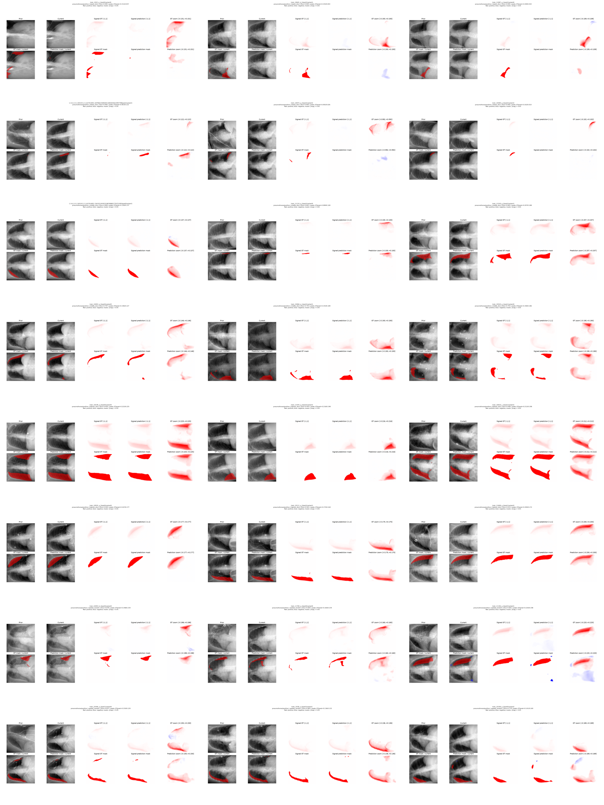

- [aa6b6839d4079099](cases/aa6b6839d4079099.png): lowest_dice, Dice 0.000
- [2fbbeaee80d504c3](cases/2fbbeaee80d504c3.png): lowest_dice, Dice 0.000
- [5cebf0d864ec93fc](cases/5cebf0d864ec93fc.png): lowest_dice, Dice 0.000
- [ba60d8bade93a5cb](cases/ba60d8bade93a5cb.png): lowest_dice, Dice 0.000
- [64a9d1d734bb094c](cases/64a9d1d734bb094c.png): lowest_dice, Dice 0.000
- [d06da5f87a41e072](cases/d06da5f87a41e072.png): lowest_dice, Dice 0.000
- [123440ea7d436c30](cases/123440ea7d436c30.png): middle_dice, Dice 0.800
- [0f387eada0381bc1](cases/0f387eada0381bc1.png): middle_dice, Dice 0.801
- [3505e8a8c6dbb30c](cases/3505e8a8c6dbb30c.png): middle_dice, Dice 0.802
- [a3b4bcfaae5a9fd6](cases/a3b4bcfaae5a9fd6.png): middle_dice, Dice 0.797
- [f504a04d4f4aa30b](cases/f504a04d4f4aa30b.png): middle_dice, Dice 0.793
- [c6b93d3ce997ba65](cases/c6b93d3ce997ba65.png): middle_dice, Dice 0.793
- [9e7fc242917b5203](cases/9e7fc242917b5203.png): highest_dice, Dice 0.956
- [20baebcd5d9a1ac3](cases/20baebcd5d9a1ac3.png): highest_dice, Dice 0.954
- [d1b1a0ed710baaa0](cases/d1b1a0ed710baaa0.png): highest_dice, Dice 0.946
- [ec1c85ddef741747](cases/ec1c85ddef741747.png): highest_dice, Dice 0.944
- [b459548172b19c30](cases/b459548172b19c30.png): highest_dice, Dice 0.941
- [1e747f999d9868cd](cases/1e747f999d9868cd.png): highest_dice, Dice 0.933
- [18336e120233909d](cases/18336e120233909d.png): seeded_random, Dice 0.878
- [cc4c7c891d9f5277](cases/cc4c7c891d9f5277.png): seeded_random, Dice 0.664
- [655e61b780d09ea5](cases/655e61b780d09ea5.png): seeded_random, Dice 0.861
- [dcea14931c48a25d](cases/dcea14931c48a25d.png): seeded_random, Dice 0.837
- [c2b837a88dbdd5b4](cases/c2b837a88dbdd5b4.png): seeded_random, Dice 0.883
- [8c239bf10fb301e5](cases/8c239bf10fb301e5.png): seeded_random, Dice 0.779
