# Val Prediction Review

Full split: 2108 pairs. Selected: 338 panels. Prediction threshold: 0.5; GT threshold: 0.05.

Red = positive change; blue = negative change. Heatmaps use fixed [-1,1] limits.
Additional zoom panels share the same per-case GT/prediction limits, printed in their titles.
Overlays show signed thresholded masks on the current image, not attention weights.
Source images use the same resizing and per-image normalization as the dataset loader.
Selection is enriched for failures and successes, not a representative performance estimate.
See report JSON for full-split metrics, CSV for every pair, and review_metadata.json for provenance.

## consolidation/below_threshold

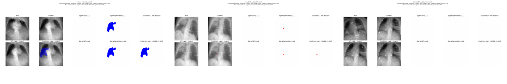

- [b248689652d64535](cases/b248689652d64535.png): lowest_dice, Dice 0.000
- [861fb8455f5c0b29](cases/861fb8455f5c0b29.png): lowest_dice, Dice 0.000
- [3ab19d90c3539ea4](cases/3ab19d90c3539ea4.png): lowest_dice, Dice 1.000

## consolidation/mixed

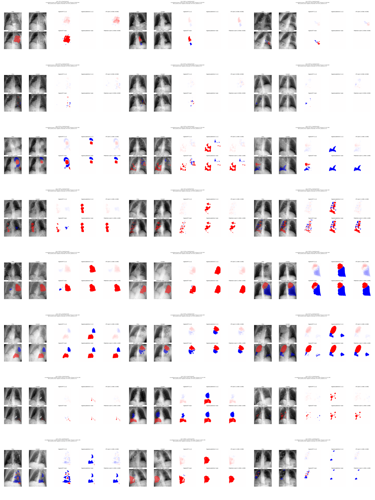

- [796cee8344c1a65c](cases/796cee8344c1a65c.png): lowest_dice, Dice 0.000
- [1bced3ebacadbd93](cases/1bced3ebacadbd93.png): lowest_dice, Dice 0.000
- [b0060134971714c9](cases/b0060134971714c9.png): lowest_dice, Dice 0.000
- [43d5e69bfabe1575](cases/43d5e69bfabe1575.png): lowest_dice, Dice 0.000
- [3da30c73697891b3](cases/3da30c73697891b3.png): lowest_dice, Dice 0.000
- [cd9a7a44b566fd2f](cases/cd9a7a44b566fd2f.png): lowest_dice, Dice 0.000
- [83b6196883d30886](cases/83b6196883d30886.png): middle_dice, Dice 0.502
- [8caf2a1f727dfc8e](cases/8caf2a1f727dfc8e.png): middle_dice, Dice 0.521
- [f7b030fc0c8c0081](cases/f7b030fc0c8c0081.png): middle_dice, Dice 0.477
- [59c7c6fd717ffd6b](cases/59c7c6fd717ffd6b.png): middle_dice, Dice 0.476
- [6150d3025b631613](cases/6150d3025b631613.png): middle_dice, Dice 0.471
- [0a8d31f4bf9361f3](cases/0a8d31f4bf9361f3.png): middle_dice, Dice 0.549
- [c497d5700d633a53](cases/c497d5700d633a53.png): highest_dice, Dice 0.896
- [302ebeb48150298f](cases/302ebeb48150298f.png): highest_dice, Dice 0.886
- [026ce6db47f3b32f](cases/026ce6db47f3b32f.png): highest_dice, Dice 0.886
- [a714fc6ce8ac9c40](cases/a714fc6ce8ac9c40.png): highest_dice, Dice 0.876
- [582c0c04188d7b43](cases/582c0c04188d7b43.png): highest_dice, Dice 0.807
- [eb52ab440ddda0a3](cases/eb52ab440ddda0a3.png): highest_dice, Dice 0.789
- [7dc0090525030a71](cases/7dc0090525030a71.png): seeded_random, Dice 0.174
- [d4ccb76f159d16f1](cases/d4ccb76f159d16f1.png): seeded_random, Dice 0.748
- [5e1081bb8683b035](cases/5e1081bb8683b035.png): seeded_random, Dice 0.330
- [6eefdf7b029db665](cases/6eefdf7b029db665.png): seeded_random, Dice 0.424
- [88f35e7e4623dea4](cases/88f35e7e4623dea4.png): seeded_random, Dice 0.749
- [9c23c0f99b37dc64](cases/9c23c0f99b37dc64.png): seeded_random, Dice 0.099

## consolidation/negative

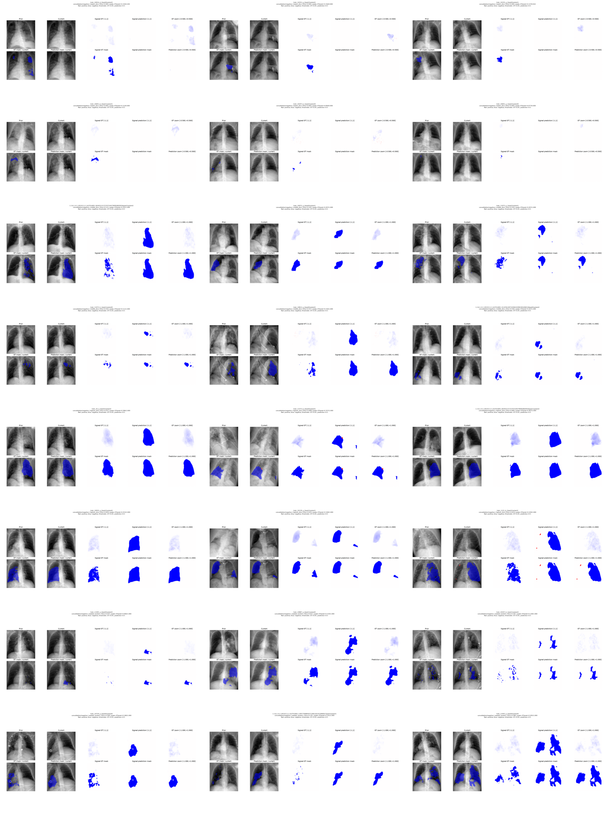

- [45c67ef693379635](cases/45c67ef693379635.png): lowest_dice, Dice 0.000
- [aa12f8e7e758eea3](cases/aa12f8e7e758eea3.png): lowest_dice, Dice 0.000
- [30594b9a2489a1e4](cases/30594b9a2489a1e4.png): lowest_dice, Dice 0.000
- [592074529e6e1328](cases/592074529e6e1328.png): lowest_dice, Dice 0.000
- [615ac8ba7d809fd0](cases/615ac8ba7d809fd0.png): lowest_dice, Dice 0.000
- [d454df1e79a87f42](cases/d454df1e79a87f42.png): lowest_dice, Dice 0.000
- [eff02aa2adb6c777](cases/eff02aa2adb6c777.png): middle_dice, Dice 0.533
- [08f8432b6290e740](cases/08f8432b6290e740.png): middle_dice, Dice 0.520
- [6274befeaa3441f9](cases/6274befeaa3441f9.png): middle_dice, Dice 0.554
- [a1e9e91220d4c7b5](cases/a1e9e91220d4c7b5.png): middle_dice, Dice 0.554
- [f9ad5427fe29f939](cases/f9ad5427fe29f939.png): middle_dice, Dice 0.557
- [bc5df8380dcbf8aa](cases/bc5df8380dcbf8aa.png): middle_dice, Dice 0.558
- [d96dee84e1a18d8d](cases/d96dee84e1a18d8d.png): highest_dice, Dice 0.931
- [f04205f8ddaa3a91](cases/f04205f8ddaa3a91.png): highest_dice, Dice 0.898
- [8806fbcd1cca6957](cases/8806fbcd1cca6957.png): highest_dice, Dice 0.885
- [99dd4d70edd40570](cases/99dd4d70edd40570.png): highest_dice, Dice 0.859
- [4b4d960f80def4bd](cases/4b4d960f80def4bd.png): highest_dice, Dice 0.835
- [85038e3522933302](cases/85038e3522933302.png): highest_dice, Dice 0.819
- [023688b8ca66224d](cases/023688b8ca66224d.png): seeded_random, Dice 0.035
- [8c9bbbf86a67298e](cases/8c9bbbf86a67298e.png): seeded_random, Dice 0.621
- [e276321b277924ef](cases/e276321b277924ef.png): seeded_random, Dice 0.301
- [d82ab3a93fa42a81](cases/d82ab3a93fa42a81.png): seeded_random, Dice 0.508
- [3e7815cd0120fe9f](cases/3e7815cd0120fe9f.png): seeded_random, Dice 0.191
- [f0a9d0f07d85fd6a](cases/f0a9d0f07d85fd6a.png): seeded_random, Dice 0.586

## consolidation/positive

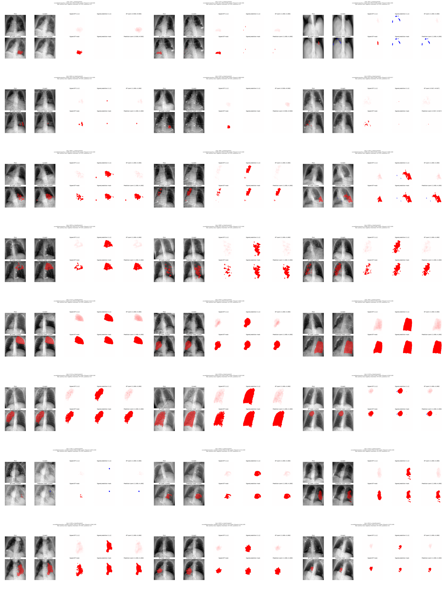

- [94f1c03858bf06e9](cases/94f1c03858bf06e9.png): lowest_dice, Dice 0.000
- [c89b04ea2dc7f723](cases/c89b04ea2dc7f723.png): lowest_dice, Dice 0.000
- [a5247203634eeefe](cases/a5247203634eeefe.png): lowest_dice, Dice 0.000
- [9004d8db66db2e04](cases/9004d8db66db2e04.png): lowest_dice, Dice 0.000
- [43ed9f89551ddb1f](cases/43ed9f89551ddb1f.png): lowest_dice, Dice 0.000
- [79ba140ee2f4f226](cases/79ba140ee2f4f226.png): lowest_dice, Dice 0.000
- [0a872b2c16b3af21](cases/0a872b2c16b3af21.png): middle_dice, Dice 0.592
- [c9b80db97bfe36e2](cases/c9b80db97bfe36e2.png): middle_dice, Dice 0.584
- [62bb9bbe3110064f](cases/62bb9bbe3110064f.png): middle_dice, Dice 0.601
- [e4f067a35c9567b3](cases/e4f067a35c9567b3.png): middle_dice, Dice 0.575
- [4b788c6fb971817e](cases/4b788c6fb971817e.png): middle_dice, Dice 0.573
- [ccab0f163de8ff9a](cases/ccab0f163de8ff9a.png): middle_dice, Dice 0.606
- [3ed8b865077b0b52](cases/3ed8b865077b0b52.png): highest_dice, Dice 0.968
- [8deb381186e29e73](cases/8deb381186e29e73.png): highest_dice, Dice 0.937
- [eb69094f568e4335](cases/eb69094f568e4335.png): highest_dice, Dice 0.933
- [512aa805db6ac87a](cases/512aa805db6ac87a.png): highest_dice, Dice 0.926
- [cf512ba90e86c64a](cases/cf512ba90e86c64a.png): highest_dice, Dice 0.897
- [ca0b6151c9630fdf](cases/ca0b6151c9630fdf.png): highest_dice, Dice 0.893
- [3f8976331723226d](cases/3f8976331723226d.png): seeded_random, Dice 0.000
- [8811cc08a4f44faa](cases/8811cc08a4f44faa.png): seeded_random, Dice 0.765
- [5be7c54e1e6d6dd7](cases/5be7c54e1e6d6dd7.png): seeded_random, Dice 0.752
- [8628182d03fec52d](cases/8628182d03fec52d.png): seeded_random, Dice 0.746
- [11358ab53920bead](cases/11358ab53920bead.png): seeded_random, Dice 0.779
- [0d5cd3d4d54d4286](cases/0d5cd3d4d54d4286.png): seeded_random, Dice 0.611

## fluid_overload/below_threshold

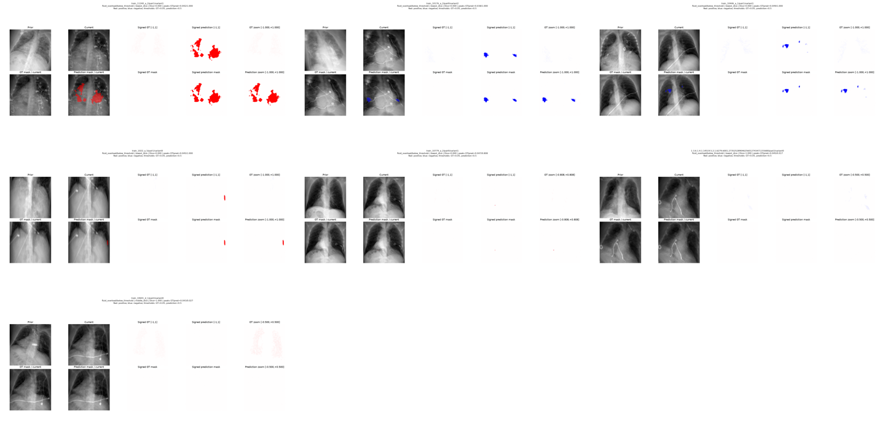

- [8321dcc2ce0b57ed](cases/8321dcc2ce0b57ed.png): lowest_dice, Dice 0.000
- [4ee773c92773c30f](cases/4ee773c92773c30f.png): lowest_dice, Dice 0.000
- [acf732762c428a34](cases/acf732762c428a34.png): lowest_dice, Dice 0.000
- [fc19ec977abec760](cases/fc19ec977abec760.png): lowest_dice, Dice 0.000
- [1bd1304ef428631e](cases/1bd1304ef428631e.png): lowest_dice, Dice 0.000
- [da99dc758d5f40ec](cases/da99dc758d5f40ec.png): lowest_dice, Dice 1.000
- [16f433c160a39bf6](cases/16f433c160a39bf6.png): middle_dice, Dice 1.000

## fluid_overload/mixed

- [8a5c70e582310aed](cases/8a5c70e582310aed.png): lowest_dice, Dice 0.000
- [8505b15ba918c87a](cases/8505b15ba918c87a.png): lowest_dice, Dice 0.427

## fluid_overload/negative

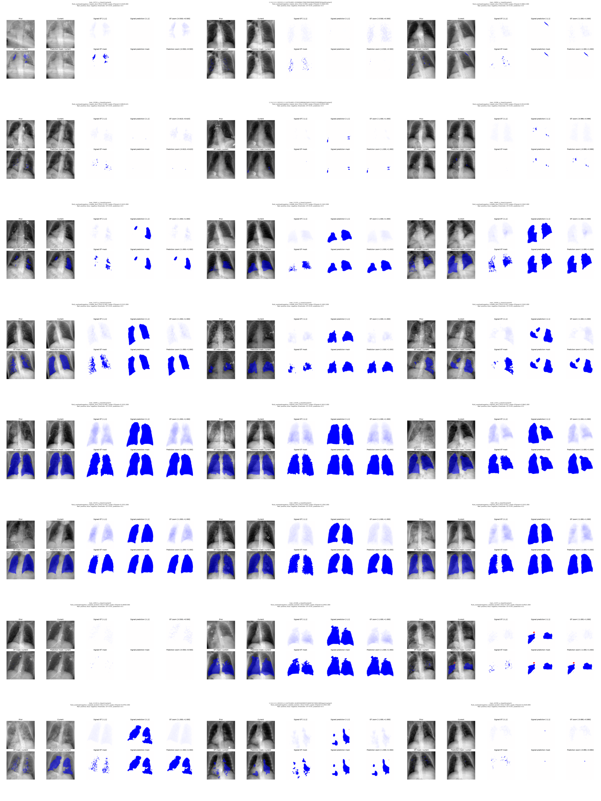

- [86b83b6c8265755b](cases/86b83b6c8265755b.png): lowest_dice, Dice 0.000
- [fd26e91f9d7c12ea](cases/fd26e91f9d7c12ea.png): lowest_dice, Dice 0.000
- [dc6f11e921b1ecea](cases/dc6f11e921b1ecea.png): lowest_dice, Dice 0.000
- [28ed8dc9c930652e](cases/28ed8dc9c930652e.png): lowest_dice, Dice 0.000
- [9a93a6466a17ca06](cases/9a93a6466a17ca06.png): lowest_dice, Dice 0.000
- [97b03fd663c1c00e](cases/97b03fd663c1c00e.png): lowest_dice, Dice 0.000
- [c281aa5441f64ed3](cases/c281aa5441f64ed3.png): middle_dice, Dice 0.576
- [8acaaee823fde216](cases/8acaaee823fde216.png): middle_dice, Dice 0.575
- [a35123a4eb38a9a7](cases/a35123a4eb38a9a7.png): middle_dice, Dice 0.570
- [9960c418da07442e](cases/9960c418da07442e.png): middle_dice, Dice 0.582
- [5ad87a2f40b1be38](cases/5ad87a2f40b1be38.png): middle_dice, Dice 0.563
- [497248bf87b60a06](cases/497248bf87b60a06.png): middle_dice, Dice 0.591
- [16f012c768092142](cases/16f012c768092142.png): highest_dice, Dice 0.945
- [5a37d20ea37bb355](cases/5a37d20ea37bb355.png): highest_dice, Dice 0.937
- [b9c520166a8da3e8](cases/b9c520166a8da3e8.png): highest_dice, Dice 0.933
- [c5a771a8805a1186](cases/c5a771a8805a1186.png): highest_dice, Dice 0.931
- [4ec581c75a9e46a0](cases/4ec581c75a9e46a0.png): highest_dice, Dice 0.929
- [fae7f28ab786eaaa](cases/fae7f28ab786eaaa.png): highest_dice, Dice 0.921
- [0e766a81d92935fb](cases/0e766a81d92935fb.png): seeded_random, Dice 0.000
- [afd5e0a7e7c55a3b](cases/afd5e0a7e7c55a3b.png): seeded_random, Dice 0.849
- [e6ff72dd48ca47a9](cases/e6ff72dd48ca47a9.png): seeded_random, Dice 0.159
- [baa3f36bfbf17a79](cases/baa3f36bfbf17a79.png): seeded_random, Dice 0.272
- [8c6d65cc73bd7029](cases/8c6d65cc73bd7029.png): seeded_random, Dice 0.643
- [d382aba1a12be81a](cases/d382aba1a12be81a.png): seeded_random, Dice 0.004

## fluid_overload/positive

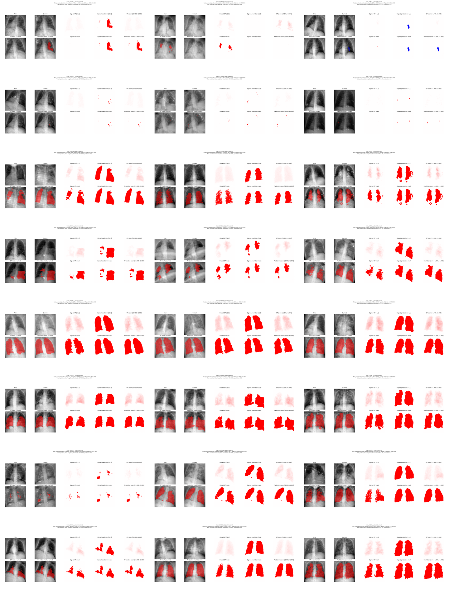

- [627072d586a98e8a](cases/627072d586a98e8a.png): lowest_dice, Dice 0.000
- [4c2d902e70c09ca2](cases/4c2d902e70c09ca2.png): lowest_dice, Dice 0.000
- [0feaccbb4988540a](cases/0feaccbb4988540a.png): lowest_dice, Dice 0.000
- [f0ce62d29ee65266](cases/f0ce62d29ee65266.png): lowest_dice, Dice 0.000
- [57560cf089129255](cases/57560cf089129255.png): lowest_dice, Dice 0.000
- [f3ffb98bb9a5566d](cases/f3ffb98bb9a5566d.png): lowest_dice, Dice 0.000
- [aa48afe44cc6f7de](cases/aa48afe44cc6f7de.png): middle_dice, Dice 0.766
- [54026aff10af2f89](cases/54026aff10af2f89.png): middle_dice, Dice 0.767
- [b1a4998ba94832e5](cases/b1a4998ba94832e5.png): middle_dice, Dice 0.761
- [631ee1b70b4c341f](cases/631ee1b70b4c341f.png): middle_dice, Dice 0.776
- [7b994b9726aebfbe](cases/7b994b9726aebfbe.png): middle_dice, Dice 0.776
- [f24471bcd9b23cf1](cases/f24471bcd9b23cf1.png): middle_dice, Dice 0.752
- [97f01127f077cbcb](cases/97f01127f077cbcb.png): highest_dice, Dice 0.940
- [56919002d0812402](cases/56919002d0812402.png): highest_dice, Dice 0.939
- [96ef1c9a67abd12f](cases/96ef1c9a67abd12f.png): highest_dice, Dice 0.937
- [e803eca9074d96c2](cases/e803eca9074d96c2.png): highest_dice, Dice 0.936
- [01eb9198ae8cfad1](cases/01eb9198ae8cfad1.png): highest_dice, Dice 0.925
- [aa54350c00575dd0](cases/aa54350c00575dd0.png): highest_dice, Dice 0.921
- [141823e60d497810](cases/141823e60d497810.png): seeded_random, Dice 0.150
- [eb6caa89180fa3ad](cases/eb6caa89180fa3ad.png): seeded_random, Dice 0.891
- [8b021b325d55c834](cases/8b021b325d55c834.png): seeded_random, Dice 0.797
- [80b62b0c754ffd0d](cases/80b62b0c754ffd0d.png): seeded_random, Dice 0.793
- [d846ec3c1fa4bbcd](cases/d846ec3c1fa4bbcd.png): seeded_random, Dice 0.825
- [35132375c1f9256f](cases/35132375c1f9256f.png): seeded_random, Dice 0.842

## nuisance

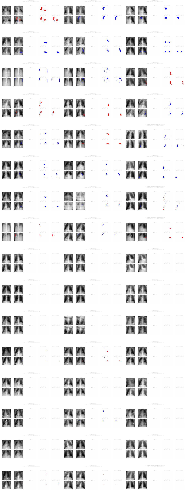

- [0eec5562d8bac8b0](cases/0eec5562d8bac8b0.png): highest_fp, FP 0.0805
- [29eb5a9714201de5](cases/29eb5a9714201de5.png): highest_fp, FP 0.0497
- [ce084a360b11f66d](cases/ce084a360b11f66d.png): highest_fp, FP 0.0442
- [7f8d4c71a475628e](cases/7f8d4c71a475628e.png): highest_fp, FP 0.0410
- [60afbabc4aabbe92](cases/60afbabc4aabbe92.png): highest_fp, FP 0.0358
- [31c7cb2cdaf262d3](cases/31c7cb2cdaf262d3.png): highest_fp, FP 0.0328
- [0fa3379f1d21cafe](cases/0fa3379f1d21cafe.png): highest_fp, FP 0.0312
- [d3fda8562cb4251b](cases/d3fda8562cb4251b.png): highest_fp, FP 0.0311
- [a7611682506457d3](cases/a7611682506457d3.png): highest_fp, FP 0.0310
- [7164b6f6bee113aa](cases/7164b6f6bee113aa.png): highest_fp, FP 0.0280
- [dfb58bb638fd49c1](cases/dfb58bb638fd49c1.png): highest_fp, FP 0.0273
- [7f1f32481bb76488](cases/7f1f32481bb76488.png): highest_fp, FP 0.0265
- [9119b7edee77ad78](cases/9119b7edee77ad78.png): highest_fp, FP 0.0237
- [ab920304988a7088](cases/ab920304988a7088.png): highest_fp, FP 0.0233
- [a07f67b4107fbc74](cases/a07f67b4107fbc74.png): highest_fp, FP 0.0221
- [b14dbc26480f16e7](cases/b14dbc26480f16e7.png): highest_fp, FP 0.0215
- [0cf294139454987f](cases/0cf294139454987f.png): highest_fp, FP 0.0214
- [55424531430328c3](cases/55424531430328c3.png): highest_fp, FP 0.0208
- [e6b0861bf4fac3ac](cases/e6b0861bf4fac3ac.png): highest_fp, FP 0.0169
- [82df45108c5221be](cases/82df45108c5221be.png): highest_fp, FP 0.0161
- [0189ebeac1e801bb](cases/0189ebeac1e801bb.png): highest_fp, FP 0.0160
- [c27e7bb3dfd60459](cases/c27e7bb3dfd60459.png): highest_fp, FP 0.0122
- [94279197288415df](cases/94279197288415df.png): highest_fp, FP 0.0100
- [2024c38a174a93f7](cases/2024c38a174a93f7.png): highest_fp, FP 0.0099
- [e376d93a8b89e32b](cases/e376d93a8b89e32b.png): seeded_random, FP 0.0000
- [e61a9a80b7652589](cases/e61a9a80b7652589.png): seeded_random, FP 0.0000
- [bcad7631ac350b14](cases/bcad7631ac350b14.png): seeded_random, FP 0.0000
- [92bbfaa8cf6c05fa](cases/92bbfaa8cf6c05fa.png): seeded_random, FP 0.0000
- [0b838dd096d052fd](cases/0b838dd096d052fd.png): seeded_random, FP 0.0000
- [4df2c7e94a533378](cases/4df2c7e94a533378.png): seeded_random, FP 0.0000
- [5d22cf4f1ff93d8d](cases/5d22cf4f1ff93d8d.png): seeded_random, FP 0.0000
- [4d9c2c1f60954f68](cases/4d9c2c1f60954f68.png): seeded_random, FP 0.0000
- [22b324b57168ffe0](cases/22b324b57168ffe0.png): seeded_random, FP 0.0000
- [702a1d9795257e7e](cases/702a1d9795257e7e.png): seeded_random, FP 0.0016
- [36d95d79d6c149f1](cases/36d95d79d6c149f1.png): seeded_random, FP 0.0061
- [172e5adb5480f346](cases/172e5adb5480f346.png): seeded_random, FP 0.0000
- [c7822e013615389e](cases/c7822e013615389e.png): seeded_random, FP 0.0000
- [104214d76d34c901](cases/104214d76d34c901.png): seeded_random, FP 0.0000
- [94acd065e28c63ab](cases/94acd065e28c63ab.png): seeded_random, FP 0.0000
- [73ac55a4b2ae85cf](cases/73ac55a4b2ae85cf.png): seeded_random, FP 0.0000
- [6ab03558712814a0](cases/6ab03558712814a0.png): seeded_random, FP 0.0076
- [f8372662070f6358](cases/f8372662070f6358.png): seeded_random, FP 0.0000
- [2e47de8af1584470](cases/2e47de8af1584470.png): seeded_random, FP 0.0000
- [bf5c5cb495777e9a](cases/bf5c5cb495777e9a.png): seeded_random, FP 0.0000
- [51c56b34954fa3e0](cases/51c56b34954fa3e0.png): seeded_random, FP 0.0000
- [7ac2f1856b982fc2](cases/7ac2f1856b982fc2.png): seeded_random, FP 0.0017
- [e235eab27fbfbb0e](cases/e235eab27fbfbb0e.png): seeded_random, FP 0.0005
- [7459ca6c5a3b00e9](cases/7459ca6c5a3b00e9.png): seeded_random, FP 0.0000

## pleural_effusion/below_threshold

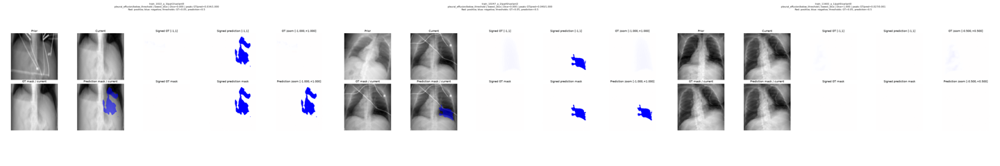

- [509a87438eafa43b](cases/509a87438eafa43b.png): lowest_dice, Dice 0.000
- [d24fd5d7e21c52f1](cases/d24fd5d7e21c52f1.png): lowest_dice, Dice 0.000
- [87ec83507387c21d](cases/87ec83507387c21d.png): lowest_dice, Dice 1.000

## pleural_effusion/mixed

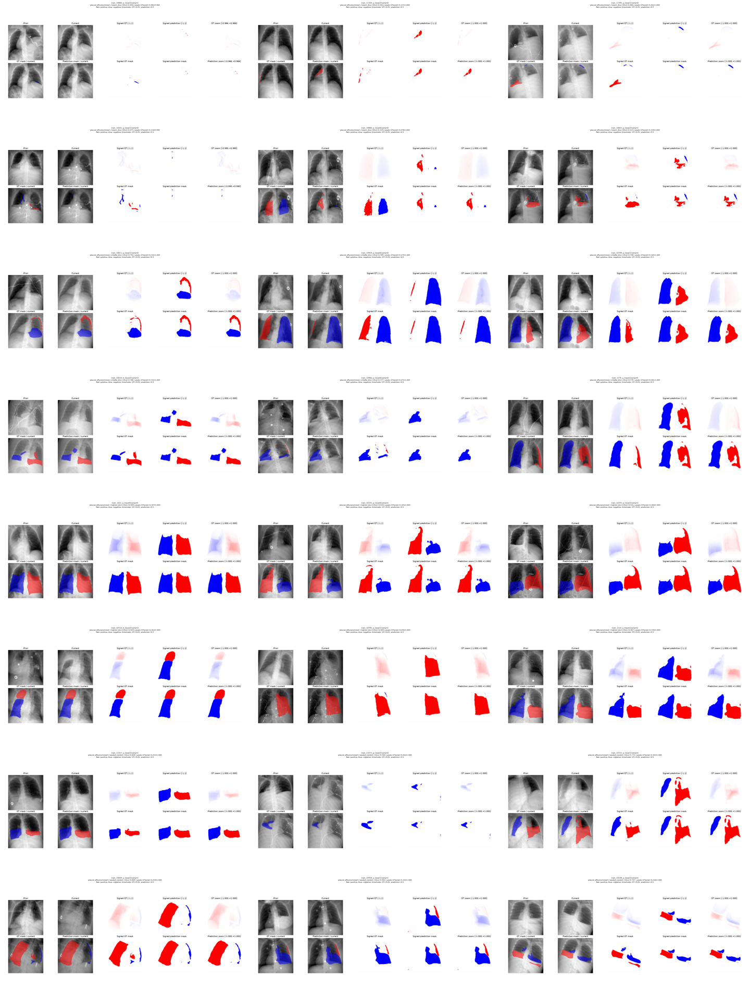

- [862f160bb0b2599a](cases/862f160bb0b2599a.png): lowest_dice, Dice 0.000
- [01e8238eef237a7e](cases/01e8238eef237a7e.png): lowest_dice, Dice 0.043
- [c022c5a12cd105b1](cases/c022c5a12cd105b1.png): lowest_dice, Dice 0.066
- [229098901eb4449a](cases/229098901eb4449a.png): lowest_dice, Dice 0.075
- [830c142a47c6f7cf](cases/830c142a47c6f7cf.png): lowest_dice, Dice 0.229
- [08da38ab55020770](cases/08da38ab55020770.png): lowest_dice, Dice 0.514
- [efe11d11b96c293d](cases/efe11d11b96c293d.png): middle_dice, Dice 0.791
- [e11ce1e64e2b63fb](cases/e11ce1e64e2b63fb.png): middle_dice, Dice 0.789
- [b01af9f2cbceb23d](cases/b01af9f2cbceb23d.png): middle_dice, Dice 0.798
- [0bbacf34227e4f43](cases/0bbacf34227e4f43.png): middle_dice, Dice 0.780
- [701d00bfd8144d7d](cases/701d00bfd8144d7d.png): middle_dice, Dice 0.777
- [c8c88bac2c69c5d2](cases/c8c88bac2c69c5d2.png): middle_dice, Dice 0.776
- [2938eaf799df7e62](cases/2938eaf799df7e62.png): highest_dice, Dice 0.949
- [ff519471a149073c](cases/ff519471a149073c.png): highest_dice, Dice 0.934
- [df54a267b8ea58bf](cases/df54a267b8ea58bf.png): highest_dice, Dice 0.931
- [f72a2571afd9b0a1](cases/f72a2571afd9b0a1.png): highest_dice, Dice 0.929
- [3dec73ef47204d5e](cases/3dec73ef47204d5e.png): highest_dice, Dice 0.909
- [ba818b29fdac5abf](cases/ba818b29fdac5abf.png): highest_dice, Dice 0.907
- [5ae197011e7e5292](cases/5ae197011e7e5292.png): seeded_random, Dice 0.828
- [0bb99a810d41c6fa](cases/0bb99a810d41c6fa.png): seeded_random, Dice 0.540
- [a234f2002b3a69b1](cases/a234f2002b3a69b1.png): seeded_random, Dice 0.772
- [7b5560facc6a3677](cases/7b5560facc6a3677.png): seeded_random, Dice 0.864
- [87ecad3408d9470b](cases/87ecad3408d9470b.png): seeded_random, Dice 0.903
- [f2a5d94506306254](cases/f2a5d94506306254.png): seeded_random, Dice 0.707

## pleural_effusion/negative

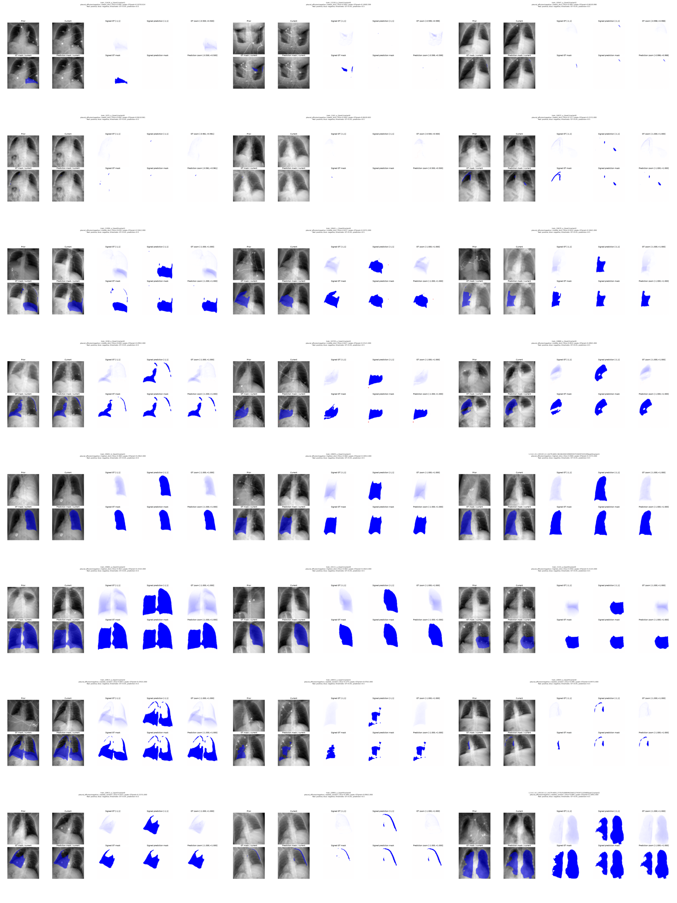

- [42840d0d89db48cc](cases/42840d0d89db48cc.png): lowest_dice, Dice 0.000
- [188012d013710984](cases/188012d013710984.png): lowest_dice, Dice 0.000
- [b16adfd900720b70](cases/b16adfd900720b70.png): lowest_dice, Dice 0.000
- [1ec25e4e1f493f2a](cases/1ec25e4e1f493f2a.png): lowest_dice, Dice 0.000
- [eeb8bbaeaa4792ab](cases/eeb8bbaeaa4792ab.png): lowest_dice, Dice 0.000
- [d1d08d1466da6f1a](cases/d1d08d1466da6f1a.png): lowest_dice, Dice 0.127
- [f4d045c4b8ab9c3b](cases/f4d045c4b8ab9c3b.png): middle_dice, Dice 0.839
- [76d0009c5b3532a8](cases/76d0009c5b3532a8.png): middle_dice, Dice 0.837
- [550741dcc9bdcef1](cases/550741dcc9bdcef1.png): middle_dice, Dice 0.834
- [102ad3ccefd3a25b](cases/102ad3ccefd3a25b.png): middle_dice, Dice 0.828
- [78fe9d756f69b00a](cases/78fe9d756f69b00a.png): middle_dice, Dice 0.827
- [9b8a6f19721f99da](cases/9b8a6f19721f99da.png): middle_dice, Dice 0.854
- [382e3d8c83d98732](cases/382e3d8c83d98732.png): highest_dice, Dice 0.984
- [dfc3b77342c9420d](cases/dfc3b77342c9420d.png): highest_dice, Dice 0.968
- [01ab0d3e7ec68ac7](cases/01ab0d3e7ec68ac7.png): highest_dice, Dice 0.968
- [d3b1f53e22fdb111](cases/d3b1f53e22fdb111.png): highest_dice, Dice 0.963
- [5eadb6abb473173e](cases/5eadb6abb473173e.png): highest_dice, Dice 0.960
- [3242ad5e519452a0](cases/3242ad5e519452a0.png): highest_dice, Dice 0.956
- [30a7037fb43c337f](cases/30a7037fb43c337f.png): seeded_random, Dice 0.863
- [7bfdd75204f78981](cases/7bfdd75204f78981.png): seeded_random, Dice 0.574
- [e4fd7bae6516d8f2](cases/e4fd7bae6516d8f2.png): seeded_random, Dice 0.496
- [c638ea6b007d7424](cases/c638ea6b007d7424.png): seeded_random, Dice 0.922
- [455809fbd8c1003a](cases/455809fbd8c1003a.png): seeded_random, Dice 0.498
- [0c040a3781bf2f41](cases/0c040a3781bf2f41.png): seeded_random, Dice 0.866

## pleural_effusion/positive

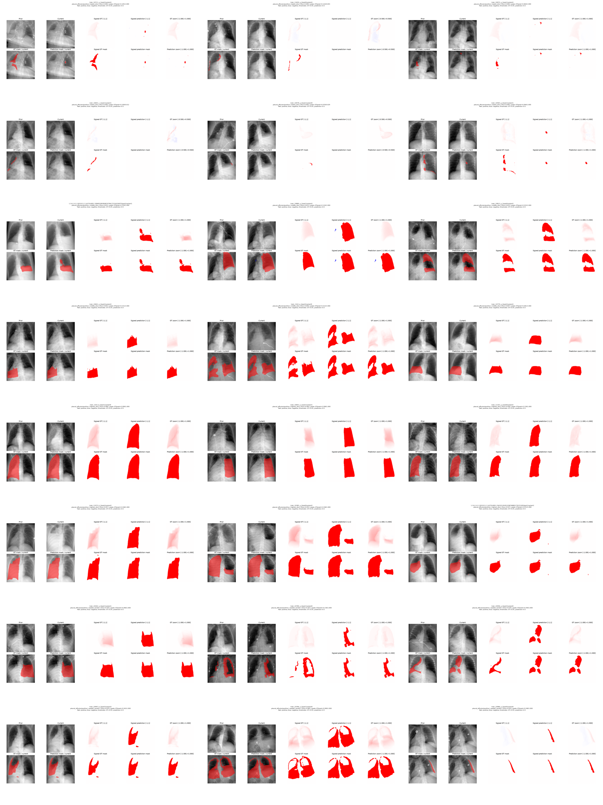

- [dc46d1906f3209c4](cases/dc46d1906f3209c4.png): lowest_dice, Dice 0.000
- [2cf627f1b0ad43ea](cases/2cf627f1b0ad43ea.png): lowest_dice, Dice 0.000
- [24552ac5d6bf869d](cases/24552ac5d6bf869d.png): lowest_dice, Dice 0.000
- [4e78f81529360099](cases/4e78f81529360099.png): lowest_dice, Dice 0.000
- [7c3c37b63ba09f7a](cases/7c3c37b63ba09f7a.png): lowest_dice, Dice 0.000
- [9ab8ceffcc7f229c](cases/9ab8ceffcc7f229c.png): lowest_dice, Dice 0.006
- [22d39927f596bf14](cases/22d39927f596bf14.png): middle_dice, Dice 0.835
- [7c45b2ec94651167](cases/7c45b2ec94651167.png): middle_dice, Dice 0.833
- [03603b521aa71bd5](cases/03603b521aa71bd5.png): middle_dice, Dice 0.832
- [ffdae8b37d5c9d70](cases/ffdae8b37d5c9d70.png): middle_dice, Dice 0.843
- [ef0d9a979a926d91](cases/ef0d9a979a926d91.png): middle_dice, Dice 0.846
- [f4f1d9580d21e0c5](cases/f4f1d9580d21e0c5.png): middle_dice, Dice 0.847
- [f92cb469aaf32182](cases/f92cb469aaf32182.png): highest_dice, Dice 0.968
- [8f20145038dbb5ef](cases/8f20145038dbb5ef.png): highest_dice, Dice 0.964
- [fdb0397cbdb026a7](cases/fdb0397cbdb026a7.png): highest_dice, Dice 0.958
- [4ea581cf47dc4d5c](cases/4ea581cf47dc4d5c.png): highest_dice, Dice 0.957
- [3a81b013d9e107e1](cases/3a81b013d9e107e1.png): highest_dice, Dice 0.955
- [67aa8059e44b967c](cases/67aa8059e44b967c.png): highest_dice, Dice 0.937
- [7b680d4c8b6c43f4](cases/7b680d4c8b6c43f4.png): seeded_random, Dice 0.916
- [a9711e8445b00e7f](cases/a9711e8445b00e7f.png): seeded_random, Dice 0.563
- [72ec64befa88902c](cases/72ec64befa88902c.png): seeded_random, Dice 0.630
- [3988fe3c0008fd0e](cases/3988fe3c0008fd0e.png): seeded_random, Dice 0.879
- [920b59e31abe9707](cases/920b59e31abe9707.png): seeded_random, Dice 0.882
- [5896a3bd05e0c1ab](cases/5896a3bd05e0c1ab.png): seeded_random, Dice 0.810

## pneumothorax/below_threshold

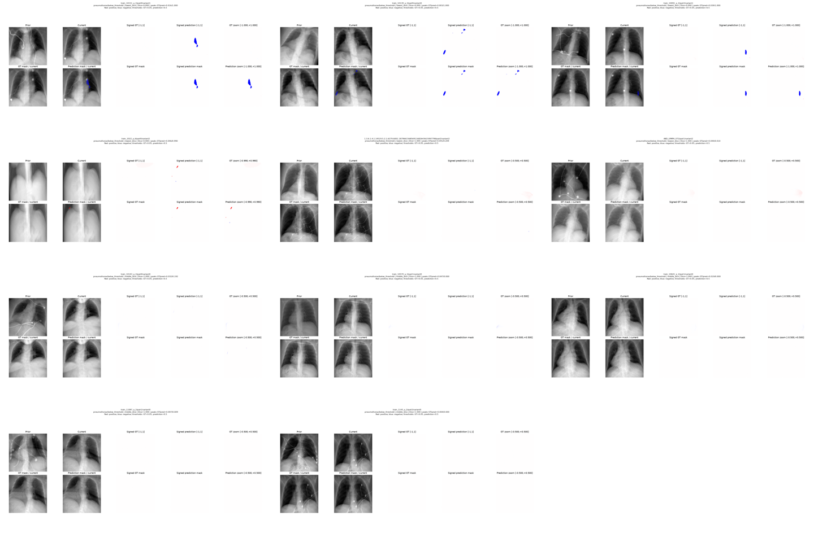

- [0bda46b44b14de6b](cases/0bda46b44b14de6b.png): lowest_dice, Dice 0.000
- [57cc318e1e1721e5](cases/57cc318e1e1721e5.png): lowest_dice, Dice 0.000
- [c27c7ecb18633866](cases/c27c7ecb18633866.png): lowest_dice, Dice 0.000
- [ad9a578eaff8aa42](cases/ad9a578eaff8aa42.png): lowest_dice, Dice 0.000
- [31d4d3265d912d26](cases/31d4d3265d912d26.png): lowest_dice, Dice 1.000
- [79b46b06fc29053a](cases/79b46b06fc29053a.png): lowest_dice, Dice 1.000
- [685a51620225800d](cases/685a51620225800d.png): middle_dice, Dice 1.000
- [8686cfef676371d5](cases/8686cfef676371d5.png): middle_dice, Dice 1.000
- [c808bd780f28a689](cases/c808bd780f28a689.png): middle_dice, Dice 1.000
- [3e8f1a7e6bddabaa](cases/3e8f1a7e6bddabaa.png): middle_dice, Dice 1.000
- [de59d285ebd126b0](cases/de59d285ebd126b0.png): middle_dice, Dice 1.000

## pneumothorax/mixed

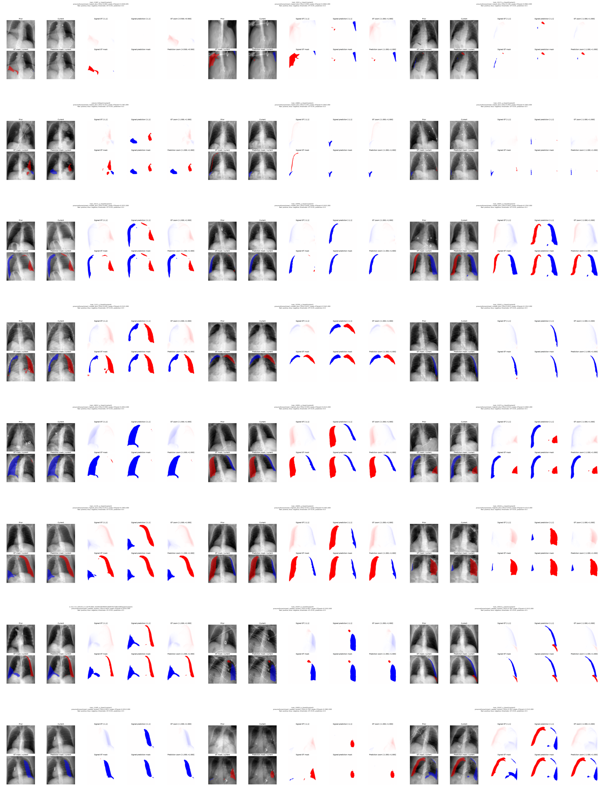

- [f28e7bb29725cfcb](cases/f28e7bb29725cfcb.png): lowest_dice, Dice 0.000
- [60cb311ba4718c86](cases/60cb311ba4718c86.png): lowest_dice, Dice 0.094
- [000497bb9421e376](cases/000497bb9421e376.png): lowest_dice, Dice 0.146
- [9d1675d5978c0e79](cases/9d1675d5978c0e79.png): lowest_dice, Dice 0.321
- [62ca66bdf9d72f81](cases/62ca66bdf9d72f81.png): lowest_dice, Dice 0.343
- [aeba4cdedb2b1b62](cases/aeba4cdedb2b1b62.png): lowest_dice, Dice 0.450
- [4f3fe4bbc898ba8b](cases/4f3fe4bbc898ba8b.png): middle_dice, Dice 0.826
- [c4011b05cc109c35](cases/c4011b05cc109c35.png): middle_dice, Dice 0.828
- [5fd9bdf4b888a1e5](cases/5fd9bdf4b888a1e5.png): middle_dice, Dice 0.824
- [d70d2fee5f63283f](cases/d70d2fee5f63283f.png): middle_dice, Dice 0.830
- [865cdf80caded991](cases/865cdf80caded991.png): middle_dice, Dice 0.831
- [3c0e590a6635826c](cases/3c0e590a6635826c.png): middle_dice, Dice 0.819
- [6d969b84ce0901a8](cases/6d969b84ce0901a8.png): highest_dice, Dice 0.940
- [d903d4a0059dc3f3](cases/d903d4a0059dc3f3.png): highest_dice, Dice 0.924
- [8269b05fa5db6e10](cases/8269b05fa5db6e10.png): highest_dice, Dice 0.915
- [c6d96b4df60c78f7](cases/c6d96b4df60c78f7.png): highest_dice, Dice 0.913
- [18b16d19ff8c27e8](cases/18b16d19ff8c27e8.png): highest_dice, Dice 0.912
- [b1445fb017d56b88](cases/b1445fb017d56b88.png): highest_dice, Dice 0.910
- [cfb9e7861b69e43b](cases/cfb9e7861b69e43b.png): seeded_random, Dice 0.854
- [791c37a7fb48cff9](cases/791c37a7fb48cff9.png): seeded_random, Dice 0.897
- [cb6f8eaf67951503](cases/cb6f8eaf67951503.png): seeded_random, Dice 0.784
- [b7b8418a77d4959b](cases/b7b8418a77d4959b.png): seeded_random, Dice 0.853
- [8b0c8c0d7fe5cdae](cases/8b0c8c0d7fe5cdae.png): seeded_random, Dice 0.700
- [ff5570e7b00ffd5f](cases/ff5570e7b00ffd5f.png): seeded_random, Dice 0.783

## pneumothorax/negative

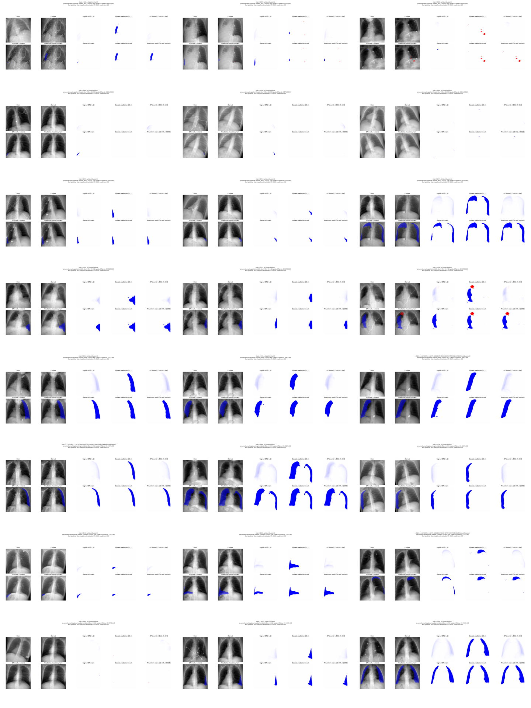

- [9c4907ae0d41ce2b](cases/9c4907ae0d41ce2b.png): lowest_dice, Dice 0.000
- [6cb01e04cb53452d](cases/6cb01e04cb53452d.png): lowest_dice, Dice 0.000
- [4869d24bc567972c](cases/4869d24bc567972c.png): lowest_dice, Dice 0.000
- [d3f51883507baa2f](cases/d3f51883507baa2f.png): lowest_dice, Dice 0.000
- [977d28436a7c63e5](cases/977d28436a7c63e5.png): lowest_dice, Dice 0.000
- [904694b8f05865eb](cases/904694b8f05865eb.png): lowest_dice, Dice 0.000
- [598fb2c49e368462](cases/598fb2c49e368462.png): middle_dice, Dice 0.755
- [bdfa052ef2212a74](cases/bdfa052ef2212a74.png): middle_dice, Dice 0.755
- [d19ab251c13e0517](cases/d19ab251c13e0517.png): middle_dice, Dice 0.759
- [7c2c1b020c30ca3c](cases/7c2c1b020c30ca3c.png): middle_dice, Dice 0.761
- [86089355bec525b0](cases/86089355bec525b0.png): middle_dice, Dice 0.748
- [1ba5fb63d32a09f1](cases/1ba5fb63d32a09f1.png): middle_dice, Dice 0.771
- [f81f90c7f72a91f9](cases/f81f90c7f72a91f9.png): highest_dice, Dice 0.944
- [ff23bb28d086f0dd](cases/ff23bb28d086f0dd.png): highest_dice, Dice 0.944
- [ffc439a360419f36](cases/ffc439a360419f36.png): highest_dice, Dice 0.931
- [1fc41481064b38a2](cases/1fc41481064b38a2.png): highest_dice, Dice 0.912
- [b6d363e2fc45007b](cases/b6d363e2fc45007b.png): highest_dice, Dice 0.911
- [b3b13300ce232972](cases/b3b13300ce232972.png): highest_dice, Dice 0.897
- [bf297422079f991f](cases/bf297422079f991f.png): seeded_random, Dice 0.389
- [b953723035ced4cc](cases/b953723035ced4cc.png): seeded_random, Dice 0.694
- [f273e47a46cf1287](cases/f273e47a46cf1287.png): seeded_random, Dice 0.645
- [0c9745237261bcb7](cases/0c9745237261bcb7.png): seeded_random, Dice 0.000
- [bf9c755b848fe730](cases/bf9c755b848fe730.png): seeded_random, Dice 0.802
- [76b61d77bc864fca](cases/76b61d77bc864fca.png): seeded_random, Dice 0.891

## pneumothorax/positive

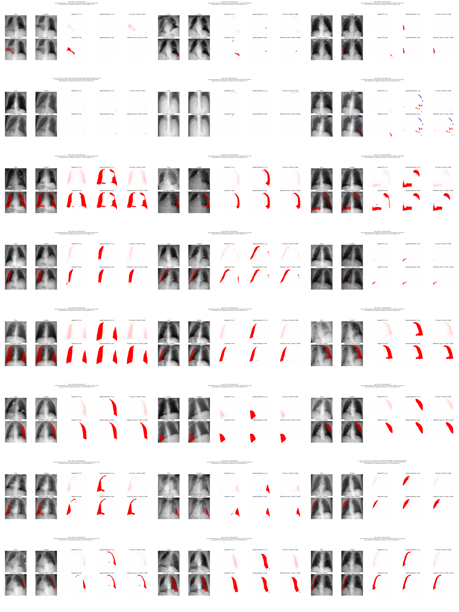

- [5cebf0d864ec93fc](cases/5cebf0d864ec93fc.png): lowest_dice, Dice 0.000
- [64a9d1d734bb094c](cases/64a9d1d734bb094c.png): lowest_dice, Dice 0.000
- [83fddeb5eda180ee](cases/83fddeb5eda180ee.png): lowest_dice, Dice 0.000
- [d04b7ec48d96ad09](cases/d04b7ec48d96ad09.png): lowest_dice, Dice 0.000
- [11feea7f65562cdf](cases/11feea7f65562cdf.png): lowest_dice, Dice 0.000
- [b2b7fb7c2d83714b](cases/b2b7fb7c2d83714b.png): lowest_dice, Dice 0.067
- [c12e42a257417945](cases/c12e42a257417945.png): middle_dice, Dice 0.819
- [b6b89f1376c076cb](cases/b6b89f1376c076cb.png): middle_dice, Dice 0.820
- [0555cecd3ecf2fe5](cases/0555cecd3ecf2fe5.png): middle_dice, Dice 0.816
- [307346da705d83a3](cases/307346da705d83a3.png): middle_dice, Dice 0.816
- [5a3885e4662c09db](cases/5a3885e4662c09db.png): middle_dice, Dice 0.815
- [833b6ba28cb8aab8](cases/833b6ba28cb8aab8.png): middle_dice, Dice 0.825
- [9e7fc242917b5203](cases/9e7fc242917b5203.png): highest_dice, Dice 0.954
- [f7a1f0e77d399642](cases/f7a1f0e77d399642.png): highest_dice, Dice 0.947
- [791669f472a49ee9](cases/791669f472a49ee9.png): highest_dice, Dice 0.938
- [1e747f999d9868cd](cases/1e747f999d9868cd.png): highest_dice, Dice 0.936
- [20baebcd5d9a1ac3](cases/20baebcd5d9a1ac3.png): highest_dice, Dice 0.933
- [b2957600e256d5ab](cases/b2957600e256d5ab.png): highest_dice, Dice 0.922
- [ceab10d8376ac8e9](cases/ceab10d8376ac8e9.png): seeded_random, Dice 0.749
- [18336e120233909d](cases/18336e120233909d.png): seeded_random, Dice 0.860
- [2dc3be3d7c27184c](cases/2dc3be3d7c27184c.png): seeded_random, Dice 0.674
- [cc4c7c891d9f5277](cases/cc4c7c891d9f5277.png): seeded_random, Dice 0.719
- [655e61b780d09ea5](cases/655e61b780d09ea5.png): seeded_random, Dice 0.901
- [c2b837a88dbdd5b4](cases/c2b837a88dbdd5b4.png): seeded_random, Dice 0.900
